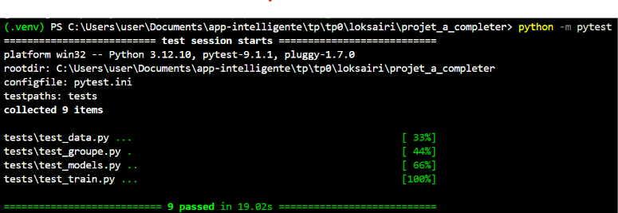
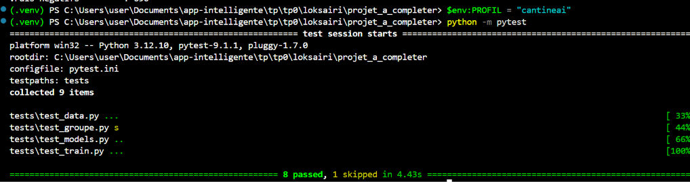
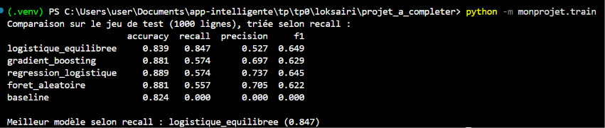
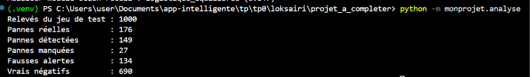
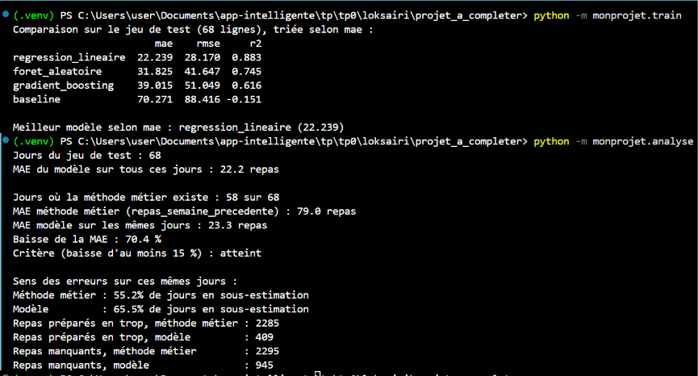

# Compte rendu — TP0 : Étude de conception, projet reproductible, entraîner et comparer des modèles

| | |
|---|---|
| **Étudiante** | Sabrine Loksairi |
| **Groupe** | Sabrine Loksairi, Aya Haffari, Mohamed Amine Farih, Yasser Rais |
| **Module** | Développement et déploiement d'applications intelligentes |
| **Séance** | Séance 3, Lab 2.1 |
| **Date** | 19/11/2026 |

## 1. Objectifs du TP

- Identifier ce qui rend un projet impossible à reproduire.
- Créer un environnement Python reproductible.
- Rédiger l'étude de conception de deux prototypes : MaintAI et CantineAI.
- Écrire le chargement des données, le découpage, les modèles candidats et leur évaluation.
- Comparer les modèles à une baseline, avec une métrique choisie à partir du coût des erreurs.
- Justifier par écrit le choix du modèle.

## 2. Environnement de travail

- Système d'exploitation : Windows
- Python : 3.11 ou version plus récente
- Bibliothèques épinglées dans `requirements.txt` : numpy 2.4.4, pandas 3.0.2, scikit-learn 1.8.0, joblib 1.5.3, pytest 9.1.1

```text
tp0/loksairi/
├── COMPTE_RENDU.md
├── captures/
├── activite1_karim/              ← vérification du projet de Karim
└── projet_a_completer/
    ├── data/                     ← exemple_pannes.csv, cantine_repas.csv
    ├── docs/                     ← choix-modele.md, etude-de-conception.md
    ├── monprojet/                ← config, data, models, train, analyse
    └── tests/                    ← 8 tests fournis et 1 test ajouté
```

## 3. Travail réalisé

### Activité 1 : faire tourner le projet de Karim

Karim annonce 14,2 % d'alertes, mais son notebook ne permet pas à quelqu'un d'autre d'obtenir ce résultat.

| # | Problème constaté | Conséquence | Correction |
|---|---|---|---|
| 1 | Chemin absolu `C:/Users/Karim/Desktop/PFE/donnees_capteurs.csv` | Le fichier est introuvable sur une autre machine | Construire le chemin dans `config.py` |
| 2 | Le notebook lit `donnees_capteurs.csv`, alors que le projet fournit `data/capteurs.csv` | Rien ne prouve que les données soient les mêmes | Livrer le fichier utilisé et le citer exactement |
| 3 | `colonnes` n'est jamais défini | `NameError` | Définir les variables d'entrée dans `config.py` |
| 4 | `seuil` n'est jamais défini | `NameError`, et le taux d'alertes dépend directement de cette valeur | Définir le seuil dans `config.py` |
| 5 | Les compteurs d'exécution sont 3, 1, 6, 4, 5, 7 et le numéro 2 manque | Les cellules n'ont pas été lancées dans l'ordre affiché, et une cellule semble avoir été supprimée | Utiliser un script lancé avec `python -m` |
| 6 | L'entraînement est placé avant le découpage | `NameError` sur `X_train` avec « Exécuter tout » | Remettre les étapes dans l'ordre |
| 7 | `train_test_split` n'a pas de `random_state` | Le résultat change à chaque lancement | Fixer une graine `SEED` |
| 8 | Pas de `requirements.txt` ni de versions, et `seaborn` est importé sans être utilisé | Bibliothèques absentes ou versions différentes | Utiliser un `.venv` et des versions épinglées |
| 9 | Le README se limite à « Ça marche chez moi », et il n'y a aucun test | Personne ne peut vérifier que le résultat est bon | Documenter les commandes et ajouter des tests `pytest` |

J'ai mesuré l'effet de ces problèmes avec `activite1_karim/verifier_reproductibilite.py`, en supposant que les variables d'entrée sont les trois capteurs et que le seuil vaut 0,5 :

- Sur 200 graines, le taux d'alertes varie de **5,5 % à 16,5 %**, avec une moyenne de 10,3 %.
- Avec `capteurs.csv`, le jeu de test contient 200 lignes : le taux d'alertes avance donc par pas de 0,5 point. **La valeur 14,2 % est impossible avec ce fichier**, quels que soient le seuil et la graine. Karim a donc utilisé d'autres données.

### Activité 2 : créer l'environnement et lancer le squelette

```powershell
python -m venv .venv
.venv\Scripts\Activate.ps1
pip install -r requirements.txt
python -m pytest
```

Le squelette donne le résultat attendu : **7 failed, 1 passed**.

**Que se passe-t-il avec `python monprojet/train.py` ?** Python affiche `ModuleNotFoundError: No module named 'monprojet'`. En lançant le fichier directement, Python cherche les modules dans le dossier `monprojet/` et non à la racine du projet. Il faut donc lancer `python -m monprojet.train` depuis la racine.

**Fonctions à écrire :**

| Fichier | Fonctions |
|---|---|
| `monprojet/data.py` | `load_data()`, `split()` |
| `monprojet/models.py` | `candidates()` |
| `monprojet/train.py` | `evaluate()`, `main()` |

### Activité 3 : étude de conception

| Section | MaintAI | CantineAI |
|---|---|---|
| **1. Utilisateur principal** | Responsable de l'équipe de maintenance | Gestionnaire de la cantine |
| **2. Décision et fréquence** | Choisir les machines à inspecter, chaque matin | Commander les repas du lendemain, chaque jour d'école à 10 h |
| **2. Coût d'une erreur** | Panne manquée : ligne arrêtée une journée pour l'usine. Fausse alerte : une heure d'inspection pour l'équipe | Repas manquant : élève sans déjeuner ou sandwich d'urgence, et plaintes. Repas en trop : environ 15 DH perdus et gaspillage |
| **3. Approche** | ML supervisé (classification). Une règle à seuil gère mal la combinaison des capteurs ; le DL et les LLM sont disproportionnés | ML supervisé (régression). La règle actuelle ignore le menu et le calendrier ; le DL est disproportionné pour 340 lignes |
| **4. Données** | `exemple_pannes.csv`, synthétique, licence non précisée, 5 000 lignes, pas de données personnelles | `cantine_repas.csv`, synthétique, licence non précisée, 340 jours, pas de données personnelles |
| **5. Baseline** | Toujours prédire « pas de panne » | Repas du même jour la semaine précédente ; dans le code, la moyenne d'entraînement |
| **5. Métrique principale** | Rappel, car une panne manquée coûte le plus cher | MAE en repas, car elle suit le nombre de repas jetés ou manquants |
| **5. Critère d'acceptation** | Rappel ≥ 0,75 et précision ≥ 0,50 sur le jeu de test (20 %, aléatoire stratifié) | MAE au moins 15 % sous la méthode actuelle, sur les 68 derniers jours d'école (découpage chronologique) |

Réglages correspondants dans `config.py` :

| Réglage | MaintAI | CantineAI |
|---|---|---|
| `DATA_PATH` | `data/exemple_pannes.csv` | `data/cantine_repas.csv` |
| `TARGET` | `failure` | `repas_servis` |
| `TASK` | `classification` | `regression` |
| `MAIN_METRIC` | `recall` | `mae` |
| `SPLIT` | `random` | `chronologique` |
| `TIME_COLUMN` | `None` | `date` |

**MaintAI : quelle accuracy pour un modèle qui ne prédit jamais de panne ?** Elle est de **82,4 %** sur le jeu de test, alors que ce modèle ne détecte aucune panne. L'accuracy ne convient donc pas : les classes sont déséquilibrées, et l'erreur la plus coûteuse devient invisible.

**CantineAI : pourquoi ne pas tirer les jours de test au hasard ?** Le modèle apprendrait sur des jours postérieurs à ceux qu'il doit prédire. En production, il ne connaît que le passé : un découpage aléatoire donnerait donc un score trop optimiste.

### Lab 2.1, partie 1 : code écrit sur MaintAI

**`load_data()`** lit le CSV, lève une `ValueError` si la cible est absente et retire les lignes sans cible.

**`split()`** gère les deux découpages sans aucun nom de colonne écrit en dur :

```python
if config.SPLIT == "random":
    stratify = y if config.TASK == "classification" else None
    return train_test_split(
        X, y, test_size=config.TEST_SIZE, random_state=config.SEED, stratify=stratify
    )

if config.SPLIT == "chronologique":
    order = pd.to_datetime(df[config.TIME_COLUMN]).argsort(kind="stable").to_numpy()
    n_test = round(len(df) * config.TEST_SIZE)
    train_positions, test_positions = order[:-n_test], order[-n_test:]
```

**`candidates()`** renvoie la baseline en premier, puis les modèles adaptés à la tâche :

| Tâche | Modèles comparés |
|---|---|
| Classification | Baseline, régression logistique, régression logistique équilibrée, forêt aléatoire, gradient boosting |
| Régression | Baseline, régression linéaire, forêt aléatoire, gradient boosting |

**`evaluate()`** calcule les métriques sur le jeu de test uniquement. **`main()`** entraîne chaque modèle sur `X_train`, affiche le tableau, puis sauvegarde `model.joblib` et `metrics.json`.

J'ai aussi ajouté `tests/test_groupe.py`, qui vérifie que la baseline MaintAI a un rappel de 0.



### Lab 2.1, partie 2 : même code sur CantineAI

Seul `config.py` change entre les deux jeux de données. La variable d'environnement `PROFIL` choisit les réglages à utiliser.



## 4. Résultats

### MaintAI

| Modèle | Rappel | Précision | F1 | Accuracy |
|---|---:|---:|---:|---:|
| Baseline | 0,000 | 0,000 | 0,000 | 0,824 |
| Forêt aléatoire | 0,557 | 0,705 | 0,622 | 0,881 |
| Gradient boosting | 0,574 | 0,697 | 0,629 | 0,881 |
| Régression logistique | 0,574 | 0,737 | 0,645 | 0,889 |
| **Régression logistique équilibrée** | **0,847** | **0,527** | **0,649** | **0,839** |

La baseline obtient bien l'accuracy de 0,824 et le rappel de 0 demandés par l'énoncé.

**Modèle retenu : la régression logistique équilibrée.** Sur 176 pannes, il en détecte 149 et en manque 27, avec 134 fausses alertes. **Le critère d'acceptation est atteint** : rappel 0,847 ≥ 0,75 et précision 0,527 ≥ 0,50. La précision reste toutefois proche du seuil, avec un intervalle de confiance à 95 % d'environ 0,47 à 0,59.





### CantineAI

| Modèle | MAE (repas) | RMSE | R² |
|---|---:|---:|---:|
| Baseline (moyenne) | 70,271 | 88,416 | -0,151 |
| Gradient boosting | 39,015 | 51,049 | 0,616 |
| Forêt aléatoire | 31,825 | 41,647 | 0,745 |
| **Régression linéaire** | **22,239** | **28,170** | **0,883** |

La baseline du code n'est pas la méthode réellement utilisée par le gestionnaire. J'ai donc aussi comparé le modèle au chiffre de la semaine précédente, sur les 58 jours de test où il existe :

| Sur 58 jours | Méthode actuelle | Régression linéaire |
|---|---:|---:|
| MAE | 79,0 repas | 23,3 repas |
| Repas préparés en trop | 2 285 | 409 |
| Repas manquants | 2 295 | 945 |
| Jours en sous-estimation | 55,2 % | 65,5 % |

**Modèle retenu : la régression linéaire.** Sa MAE est 70,4 % plus basse que celle de la méthode actuelle : **le critère d'acceptation est atteint**. Sa principale limite est de sous-estimer plus souvent, alors qu'un repas manquant pénalise directement un élève.



### Activité 4 : le groupe au meilleur score a-t-il le meilleur modèle ?

Pas forcément. Les groupes n'ont ni les mêmes données ni les mêmes métriques, et un score élevé peut venir d'un problème facile. Il faut regarder l'écart avec la baseline et le critère d'acceptation, sur un jeu de test tenu à l'écart.

### Ticket de sortie

1. **Baseline et score :** pour MaintAI, « jamais de panne » obtient une accuracy de 0,824 et un rappel de 0. Pour CantineAI, la méthode actuelle obtient une MAE de 79,0 repas.
2. **Pourquoi le même jeu de test ?** Pour que les écarts viennent des modèles et non de la difficulté des lignes évaluées.
3. **Quand l'accuracy peut-elle tromper ?** Quand les classes sont déséquilibrées : MaintAI atteint 82,4 % sans détecter aucune panne.

## 5. Difficultés rencontrées

| Problème | Cause | Solution |
|---|---|---|
| `ModuleNotFoundError: No module named 'monprojet'` | Le fichier était lancé directement | Lancer `python -m monprojet.train` depuis la racine |
| Rappel limité à environ 0,57 avec les modèles standards | Les pannes sont minoritaires (17,6 %) | Ajouter `class_weight="balanced"` |
| La baseline `DummyRegressor` ne représente pas la méthode du gestionnaire | Le test impose un modèle factice en premier | Ajouter la comparaison métier dans `monprojet/analyse.py` |
| `repas_semaine_precedente` est vide pour 60 jours | Il n'y a pas de semaine précédente après les vacances | Imputer la médiane pour les modèles et limiter la comparaison métier aux jours disponibles |

## 6. Exécution du travail

Depuis `tp/tp0/loksairi/projet_a_completer` :

```powershell
python -m venv .venv
.venv\Scripts\Activate.ps1
pip install -r requirements.txt

# MaintAI
python -m pytest
python -m monprojet.train
python -m monprojet.analyse

# CantineAI
$env:PROFIL = "cantineai"
python -m pytest
python -m monprojet.train
python -m monprojet.analyse
Remove-Item Env:PROFIL
```

Résultats attendus : `9 passed` pour MaintAI et `8 passed, 1 skipped` pour CantineAI. Le test ignoré concerne le rappel, qui ne s'applique pas à une régression.

Les détails sont dans `docs/choix-modele.md` et `docs/etude-de-conception.md`.

## 7. Conclusion

Ce TP montre qu'un résultat n'a de valeur que si un autre peut le reproduire et le comparer à une référence. Le même code a fonctionné sur MaintAI et CantineAI en changeant uniquement `config.py`. Les deux modèles retenus atteignent leur critère d'acceptation, mais leurs limites restent à surveiller : la précision de MaintAI est proche du seuil, et CantineAI sous-estime plus souvent qu'il ne surestime.
