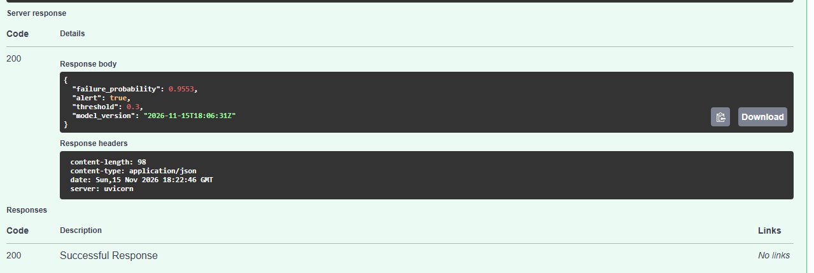
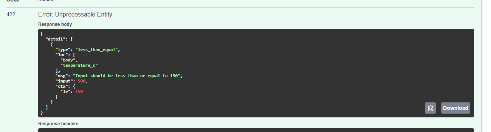

# Compte rendu · TP1 : une API de prédiction pour MaintAI

**Groupe :** G1 5IA  ·  **Membres :** Aya Haffari  ·  **Date :** 15/11/2026

---

## 1. Mise en place

Dernière ligne de `python -m pytest`, juste après la mise en place (rien n'est encore écrit) :

```
3 failed, 10 passed, 1 warning in 6.38s
```

Dans `tests/test_api.py`, 4 tests sur 7 passent déjà alors que rien n'est écrit. Lesquels ? Pour les deux tests qui attendent un code 422, expliquez pourquoi ils passent « pour une mauvaise raison » (indice : regardez `extra="forbid"` dans `schemas.py`).

Les quatre tests qui passent sont `test_health`, `test_openapi_documents_predict`, `test_out_of_range_value_is_rejected` et `test_missing_field_is_rejected`. Les deux derniers attendent un 422 et passent « pour une mauvaise raison » : au départ, `SensorReading` ne contient aucun champ et `extra="forbid"` refuse tout champ inconnu. Donc **tous** les relevés sont refusés avec un 422, même un relevé valide. Le test de la température de 500 °C est vert, mais ce n'est pas parce que l'API a vérifié la température : elle refuse tout. C'est pour cela que les tests qui envoient un bon relevé (200 attendu) échouent encore.

## 2. Le schéma d'entrée (`maintai/api/schemas.py`)

| Variable | Type | Minimum (`ge`) | Maximum (`le`) | Justification physique (pas le min / max des données) |
|---|---|---|---|---|
| `temperature_c` | `float` | -40 | 150 | Plage d'un moteur industriel : du froid extrême d'un entrepôt à la surchauffe avant destruction de l'isolation. |
| `vibration_mm_s` | `float` | 0 | 50 | Une vitesse de vibration n'est jamais négative ; au-delà d'environ 11 mm/s la machine est en zone dangereuse, 50 laisse une marge pour un capteur déréglé. |
| `load_pct` | `float` | 0 | 120 | Pourcentage de la charge nominale : une surcharge temporaire jusqu'à 120 % est possible. |
| `runtime_hours` | `float` | 0 | 100000 | Environ 11 ans de marche continue, au-delà de la durée de vie d'une machine. |

Après avoir écrit `schemas.py` seul, que donne `python -m pytest`, et quel est le message d'erreur des tests qui échouent ? Pourquoi est-ce un bon signe ?

```
FAILED tests/test_api.py::test_predict_returns_probability - NotImplementedError
FAILED tests/test_api.py::test_high_risk_reading_raises_alert - NotImplementedError
FAILED tests/test_api.py::test_503_when_model_missing - NotImplementedError
3 failed, 10 passed, 1 warning in 12.06s
```

Il y a toujours 3 tests qui échouent, mais l'erreur n'est plus un `422` : c'est `NotImplementedError`. C'est un bon signe, car le schéma accepte maintenant les relevés valides : la requête n'est plus refusée à l'entrée, elle arrive jusqu'à la fonction `predict()`, qui n'est pas encore écrite et lève l'exception prévue par le starter.

## 3. La fonction `predict()` (`maintai/api/main.py`)

Votre code :

```python
@router.post("/predict", response_model=PredictionOut)
def predict(reading: SensorReading) -> PredictionOut:
    predictor = state.get("predictor")
    if predictor is None:
        raise HTTPException(
            status_code=503,
            detail="Modèle non chargé : lancez python -m maintai.train, puis relancez l'API.",
        )
    return PredictionOut(**predictor.predict(reading.model_dump()))
```

Pourquoi répondre **503** et pas 500 quand le modèle manque ?

Un 500 veut dire « bug dans le serveur ». Ici ce n'est pas un bug : le service est correct, mais il est **temporairement indisponible** parce que le modèle n'a pas été entraîné. Le 503 (« Service Unavailable ») le dit clairement à celui qui appelle, et le message indique quoi faire (`python -m maintai.train`, puis relancer l'API).

Pourquoi le modèle est-il chargé **une seule fois**, au démarrage, et pas à chaque requête ?

Lire `model.joblib` sur le disque et le reconstruire prend du temps. Si on le faisait à chaque requête, chaque prédiction serait lente et l'API ferait un travail inutile des centaines de fois. Chargé une fois dans `state` au démarrage, le modèle reste en mémoire et chaque requête n'a plus qu'à calculer la prédiction.

## 4. Les tests

Dernière ligne de `python -m pytest` à la fin du TP :

```
13 passed, 1 warning in 5.75s
```

## 5. L'API en marche

Après `python -m maintai.dataset` et `python -m maintai.train`, `python -m uvicorn maintai.api.main:app`, puis les requêtes avec `curl.exe` :

| Requête | Code obtenu | Réponse (le corps JSON) |
|---|---|---|
| `GET /health` | 200 | `{"status":"ok","model_loaded":true}` |
| `POST /v1/predict` avec `{"temperature_c": 72.5, "vibration_mm_s": 6.1, "load_pct": 85, "runtime_hours": 15000}` | 200 | `{"failure_probability":0.9553,"alert":true,"threshold":0.3,"model_version":"2026-11-15T18:06:31Z"}` |
| `POST /v1/predict` avec une température de 500 | 422 | `{"detail":[{"type":"less_than_equal","loc":["body","temperature_c"],"msg":"Input should be less than or equal to 150","input":500,"ctx":{"le":150.0}}]}` |
| `POST /v1/predicte` (faute de frappe dans l'adresse) | 404 | `{"detail":"Not Found"}` |

Dans `/docs` (`http://127.0.0.1:8000/docs`), la réponse **200** pour le relevé valide :



et la réponse **422** pour une température de 500 :



Dans `/docs`, où voit-on les bornes que vous avez choisies ?

Dans la section **Schemas**, en bas de la page, sous `SensorReading` : chaque champ y est listé avec son type, sa description et ses bornes (par exemple `temperature_c` : minimum -40, maximum 150). On les voit aussi dans le message du 422, qui rappelle la borne dépassée (`"le": 150`).

## 6. Questions de compréhension

1. REST et FastAPI : quelle est la différence ?

   REST est un **style** : une façon de concevoir une API (des adresses qui désignent des ressources, des verbes HTTP comme GET et POST, des codes de réponse). FastAPI est un **outil** Python qui permet de construire une telle API rapidement. On peut faire du REST avec d'autres outils, et FastAPI ne force pas à respecter REST.

2. Le schéma Pydantic sert à trois choses. Lesquelles ?

   (1) **Valider** les données reçues : types et bornes, avec un 422 automatique si elles sont invalides ; (2) **convertir** le JSON en objet Python utilisable (`reading.model_dump()`) ; (3) **documenter** l'API : les champs, descriptions et bornes apparaissent dans `/docs`.

3. Dans `http://localhost:8000/v1/predict`, que désignent `localhost`, `8000` et `/v1/predict` ?

   `localhost` est **la machine sur laquelle on se trouve** (mon PC). `8000` est le **port**, le numéro de la « porte » sur laquelle uvicorn écoute. `/v1/predict` est le **chemin** de la ressource demandée, ici la prédiction de la version 1 de l'API.

4. Pourquoi `/v1` dans l'adresse ?

   C'est la **version** de l'API. Si on change un jour le format d'entrée ou de sortie, on pourra publier `/v2` sans casser les programmes qui utilisent encore `/v1`.

5. Dans la commande `uvicorn maintai.api.main:app`, que désignent `maintai.api.main` et `app` ?

   `maintai.api.main` est le **module Python** : le fichier `maintai/api/main.py`. `app` est le **nom de l'objet** `FastAPI` défini dans ce fichier (`app = FastAPI(...)`). Uvicorn importe le module et démarre cet objet.

## 7. Le rendu Git

- Dépôt du groupe : https://github.com/Sabrineloksairi/app-intelligente/tree/main/tp/tp1/haffari (dépôt direct sur `main`, dossier `tp/tp1/haffari/`)
- Ce TP a d'abord été fait sur mon dépôt personnel : pull request https://github.com/eyahaf2/maintai-tp/pull/3, tag `tp1` : oui
- Qui a relu la pull request, et quel commentaire a-t-il laissé ?
  Sur mon dépôt personnel, j'ai travaillé seule : je me suis relue moi-même avant de fusionner, avec ce commentaire : « Relu : 13 tests passent, aucun `.env`, `.venv` ni `models` dans les fichiers modifiés, l'ADR 002 justifie les bornes et le 503, le compte rendu est rempli. » Dans le dépôt de groupe, il n'y a pas de pull request : le dépôt se fait directement sur `main`.

## 8. Ce qui reste flou

Ce qui m'a surpris, c'est de comprendre pourquoi un test vert ne prouve rien : les deux tests de 422 passaient dès le départ alors que le schéma était vide. J'ai aussi appris la différence entre deux 422 : en testant dans `/docs`, j'ai d'abord oublié une virgule dans mon JSON et j'ai obtenu `json_invalid` (JSON mal écrit), alors que 500 °C donne `less_than_equal` (valeur hors borne). Ce qui reste un peu flou, c'est comment choisir des bornes vraiment justes sans l'avis d'un technicien de maintenance, et quand préférer refuser de démarrer plutôt que répondre 503 quand le modèle manque.
