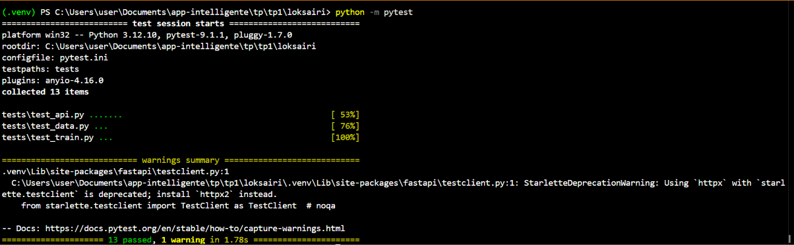
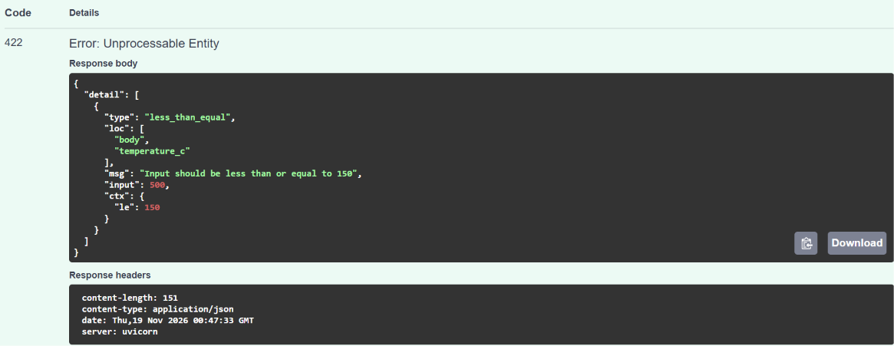

# Compte rendu · TP1 : une API de prédiction pour MaintAI

**Groupe :** Sabrine Loksairi, Aya Haffari, Mohamed Amine Farih, Yasser Rais  ·  **Rédigé par :** Sabrine Loksairi  ·  **Date :** 19/11/2026

---

## 1. Mise en place

Dernière ligne de `python -m pytest`, juste après la mise en place (rien n'est encore écrit) :

```
=================== 3 failed, 10 passed, 1 warning in 1.10s ====================
```

Dans `tests/test_api.py`, 4 tests sur 7 passent déjà alors que rien n'est écrit. Lesquels ? Pour les deux tests qui attendent un code 422, expliquez pourquoi ils passent « pour une mauvaise raison » (indice : regardez `extra="forbid"` dans `schemas.py`).

Les 4 tests qui passent sont :

- `test_health`
- `test_out_of_range_value_is_rejected`
- `test_missing_field_is_rejected`
- `test_openapi_documents_predict`

Les deux tests qui attendent un 422 sont `test_out_of_range_value_is_rejected` et `test_missing_field_is_rejected`. Ils passent pour une mauvaise raison : le schéma est vide et `extra="forbid"` refuse tout champ inconnu. Chaque champ envoyé est donc rejeté, même dans un relevé valide. Le 422 ne prouve ni que 500 °C est hors bornes, ni que l'absence de `load_pct` est détectée.

## 2. Le schéma d'entrée (`maintai/api/schemas.py`)

| Variable | Type | Minimum (`ge`) | Maximum (`le`) | Justification physique (pas le min / max des données) |
|---|---|---:|---:|---|
| `temperature_c` | `float` | -40 | 150 | Bornes données par l'énoncé : démarrage à froid d'un côté, surchauffe extrême de l'autre. |
| `vibration_mm_s` | `float` | 0 | 100 | Une vitesse efficace n'est jamais négative. La zone D de la norme ISO 20816-3 commence entre 4,5 et 7,1 mm/s sur support rigide : 100 mm/s accepte donc les machines très dégradées. |
| `load_pct` | `float` | 0 | 150 | 0 % correspond à une machine à vide, et une surcharge au-delà de 100 % reste possible. Au-delà de 150 %, la lecture est considérée comme aberrante. |
| `runtime_hours` | `float` | 0 | 200000 | Un compteur d'heures n'est jamais négatif. 200 000 h représentent environ 23 ans de fonctionnement continu. |

Après avoir écrit `schemas.py` seul, que donne `python -m pytest`, et quel est le message d'erreur des tests qui échouent ? Pourquoi est-ce un bon signe ?

```
FAILED tests/test_api.py::test_predict_returns_probability - NotImplementedError
FAILED tests/test_api.py::test_high_risk_reading_raises_alert - NotImplemente...
FAILED tests/test_api.py::test_503_when_model_missing - NotImplementedError
=================== 3 failed, 10 passed, 1 warning in 2.08s ====================
```

C'est un bon signe, car l'erreur a changé : les relevés valides ne sont plus refusés par un 422. Ils franchissent la validation et arrivent jusqu'à `predict()`, la seule partie qui reste à écrire.

## 3. La fonction `predict()` (`maintai/api/main.py`)

Votre code :

```python
predictor = state.get("predictor")
if predictor is None:
    raise HTTPException(
        status_code=503,
        detail="Modèle non chargé : lancez python -m maintai.train, puis redémarrez l'API.",
    )
return PredictionOut(**predictor.predict(reading.model_dump()))
```

Pourquoi répondre **503** et pas 500 quand le modèle manque ?

Le code 500 signale un bug imprévu dans le serveur. Ici, la situation est connue : la requête est correcte, mais le service ne peut pas y répondre tant que le modèle n'est pas disponible. Le code 503 le dit clairement, et le message indique comment corriger le problème.

Pourquoi le modèle est-il chargé **une seule fois**, au démarrage, et pas à chaque requête ?

Lire le modèle sur le disque prend du temps. En le chargeant une seule fois, chaque requête réutilise le modèle déjà en mémoire : les réponses sont plus rapides, et toutes les requêtes utilisent la même version.

## 4. Les tests

Dernière ligne de `python -m pytest` à la fin du TP :

```
==================== 13 passed, 1 warning in 1.78s =====================
```



## 5. L'API en marche

Après `python -m maintai.dataset` et `python -m maintai.train`, lancez `uvicorn maintai.api.main:app --reload`, puis envoyez ces requêtes depuis `/docs` (ou avec `curl.exe`).

| Requête | Code obtenu | Réponse (le corps JSON) |
|---|---:|---|
| `GET /health` | 200 | `{"status":"ok","model_loaded":true}` |
| `POST /v1/predict` avec `{"temperature_c": 72.5, "vibration_mm_s": 6.1, "load_pct": 85, "runtime_hours": 15000}` | 200 | `{"failure_probability":0.9553,"alert":true,"threshold":0.3,"model_version":"2026-11-19T00:31:30Z"}` |
| `POST /v1/predict` avec une température de 500 | 422 | `{"detail":[{"type":"less_than_equal","loc":["body","temperature_c"],"msg":"Input should be less than or equal to 150","input":500,"ctx":{"le":150.0}}]}` |
| `POST /v1/predicte` (faute de frappe dans l'adresse) | 404 | `{"detail":"Not Found"}` |

`model_version` est la date de l'entraînement : cette valeur change à chaque nouvel entraînement.



Dans `/docs`, où voit-on les bornes que vous avez choisies ?

Dans la section **Schemas**, en bas de la page : en ouvrant `SensorReading`, chaque champ affiche son type, son minimum, son maximum et sa description. On les retrouve aussi dans l'onglet **Schema** du corps de la requête `POST /v1/predict`.

## 6. Questions de compréhension

1. REST et FastAPI : quelle est la différence ?
   REST est un ensemble de règles pour concevoir une API web. FastAPI est une bibliothèque Python qui permet d'écrire une API respectant ces règles.
2. Le schéma Pydantic sert à trois choses. Lesquelles ?
   Il valide les données reçues, génère la documentation de `/docs` et fournit à la fonction un objet Python typé.
3. Dans `http://localhost:8000/v1/predict`, que désignent `localhost`, `8000` et `/v1/predict` ?
   `localhost` désigne la machine elle-même, `8000` le port sur lequel uvicorn écoute, et `/v1/predict` la route définie dans le code.
4. Pourquoi `/v1` dans l'adresse ?
   C'est la version de l'API. Le contrat peut ainsi évoluer dans une future version `/v2` sans casser les clients qui utilisent `/v1`.
5. Dans la commande `uvicorn maintai.api.main:app`, que désignent `maintai.api.main` et `app` ?
   `maintai.api.main` désigne le fichier `maintai/api/main.py`, et `app` la variable de ce fichier qui contient l'application FastAPI.

## 7. Le rendu Git

- Lien de la pull request : à compléter après son ouverture
- Le tag `tp1` existe sur GitHub : à compléter après la fusion
- Qui a relu la pull request, et quel commentaire a-t-il laissé ?
  À compléter après la relecture

## 8. Ce qui reste flou

Je dois encore approfondir le comportement du modèle quand une valeur acceptée par l'API sort du domaine d'entraînement, par exemple 150 000 heures de fonctionnement. Je me demande aussi comment renvoyer proprement un code 422 pour la valeur `NaN`, qui provoque aujourd'hui une erreur 500.
