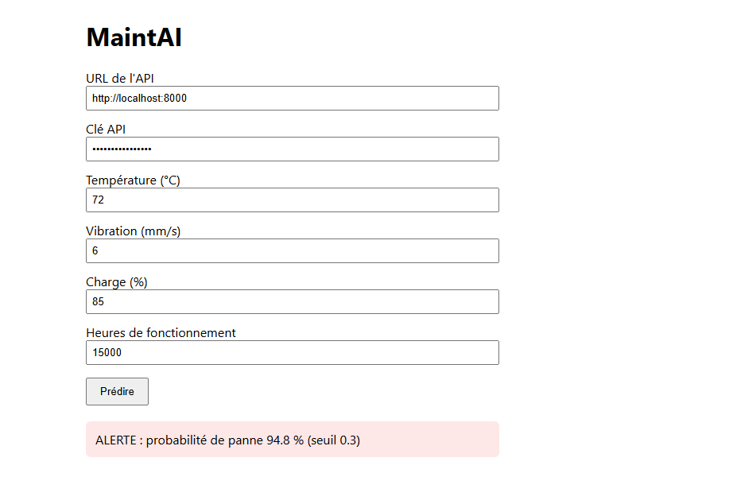
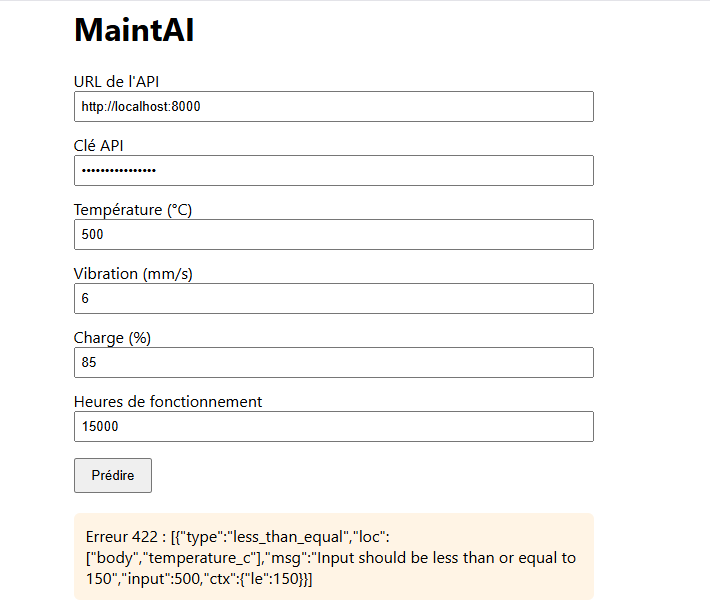
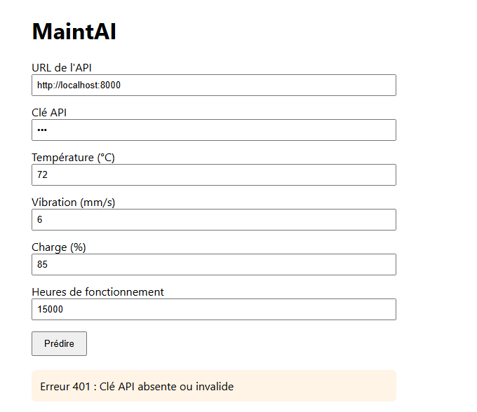
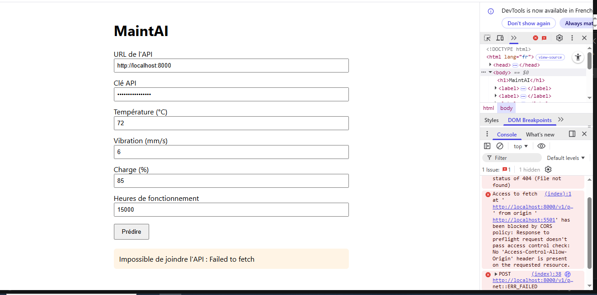

# Compte rendu · TP2 : tester, sécuriser et appeler l'API MaintAI

**Groupe :** G1 5IA  ·  **Membres :** Aya Haffari  ·  **Date :** 19 novembre 2026

---

## 1. Activité 1 : casser son API (dans `TP/TP1`)

Vos cinq requêtes, le code que vous aviez **prévu**, puis le code **obtenu** :

| Requête | Ce qui ne va pas | Code prévu | Code obtenu |
|---|---|---|---|
| 1 | champ manquant (`load_pct` absent) | 422 | 422 |
| 2 | valeur absurde (`temperature_c` = 500) | 422 | 422 |
| 3 | texte au lieu d'un nombre (`"chaud"`) | 422 | 422 |
| 4 | champ en trop (`couleur`) | 422 | 422 |
| 5 | mauvaise route (`/v1/predict_tout`) | 404 | 404 |

Une de vos prévisions était-elle fausse ? Laquelle, et pourquoi ?

Non, les cinq prévisions étaient justes. Ce que j'ai appris en regardant les messages : la borne de la température est 150 (pas 500), et le champ en trop est refusé à cause de `extra="forbid"` (`extra_forbidden`). Les quatre premières requêtes arrivent sur une route qui existe mais avec un contenu qui viole les règles de validation (422). La dernière vise une adresse qui n'existe pas (404).

Dernière ligne de `python -m pytest` avec `tests/test_casser.py` (dans `TP/TP1`) :

```
========================================= 18 passed, 1 warning in 3.42s =========================================
```

(`pytest tests\test_casser.py` seul : `5 passed, 1 warning in 2.98s`.)

À quoi sert `@pytest.mark.parametrize` ? Combien de tests pytest compte-t-il pour votre fonction, et pourquoi ?

`@pytest.mark.parametrize` permet d'écrire une seule fonction de test et de la lancer sur plusieurs jeux de données. Pytest compte **5 tests** pour ma fonction `test_requete_invalide` : un par cas de la liste `CAS`. Chaque cas est exécuté et affiché séparément, donc si un seul échoue, on voit lequel.

## 2. ruff

Sortie de `ruff check .` dans `TP/TP1` :

```
UP017 [*] Use `datetime.UTC` alias
  --> maintai\train.py:58:36
   |
58 |         "trained_at": datetime.now(timezone.utc).strftime("%Y-%m-%dT%H:%M:%SZ"),
   |                                    ^^^^^^^^^^^^
help: Convert to `datetime.UTC` alias

Found 1 error.
[*] 1 fixable with `--fix`.
```

Après `ruff check . --fix` : `Found 3 errors (3 fixed, 0 remaining).` puis `ruff check .` : `All checks passed!`. Les tests passent toujours (`18 passed`).

Quelle différence entre `ruff check .` et `python -m pytest` ? Que vérifie chacun ?

`pytest` exécute le programme et vérifie son **comportement** (les résultats sont-ils ceux attendus ?). `ruff` lit le code **sans l'exécuter** et vérifie sa **qualité** : style, imports inutiles, pratiques modernes. Ici pytest ne voyait aucun problème alors que ruff en a trouvé un (`timezone.utc` à remplacer par `UTC`) : les deux outils sont complémentaires.

## 3. Mise en place du TP2 (dans `TP/TP2`)

Dernière ligne de `python -m pytest` juste après la mise en place :

```
================================================ 2 failed, 16 passed, 1 warning in 6.10s =================================================
```

Quels sont les deux tests qui échouent, et que reçoivent-ils au lieu de 401 ?

Les tests `test_missing_key_is_rejected` (requête sans clé) et `test_wrong_key_is_rejected` (requête avec une fausse clé). Ils reçoivent **200** au lieu de 401 : l'API n'est pas encore protégée, elle répond à tout le monde.

## 4. La clé API (sprint 1)

Votre fonction `require_api_key()` (`maintai/api/security.py`) :

```python
def require_api_key(x_api_key: str | None = Header(default=None)) -> None:
    """Refuse la requête si la clé est absente ou fausse."""
    expected = get_settings().api_key
    if expected is None:
        # Le serveur est mal configuré : ce n'est pas la faute du client (500, pas 401)
        raise HTTPException(
            status_code=status.HTTP_500_INTERNAL_SERVER_ERROR,
            detail="Clé API non configurée sur le serveur",
        )
    if x_api_key is None or not secrets.compare_digest(
        x_api_key.encode("utf-8"), expected.encode("utf-8")
    ):
        raise HTTPException(
            status_code=status.HTTP_401_UNAUTHORIZED,
            detail="Clé API absente ou invalide",
        )
```

Votre ligne `router = ...` dans `maintai/api/main.py` :

```python
router = APIRouter(prefix="/v1", dependencies=[Depends(require_api_key)])
```

Après avoir écrit `security.py` seul (sans toucher au router), combien de tests échouent ? Pourquoi ?

**2 tests** échouent encore (`2 failed, 16 passed`), exactement les mêmes qu'avant. La fonction existe, mais personne ne l'appelle : tant qu'elle n'est pas branchée sur le router avec `dependencies=[Depends(require_api_key)]`, FastAPI ne la vérifie jamais.

Dernière ligne de `python -m pytest` à la fin du sprint 1 :

```
18 passed, 1 warning
```

Requêtes envoyées avec `curl.exe` (serveur lancé avec `--env-file .env`) :

| Requête | Code obtenu | Réponse (le corps JSON) |
|---|---|---|
| `GET /health`, sans clé | 200 | `{"status":"ok","model_loaded":true}` |
| `POST /v1/predict`, relevé normal, sans clé | 401 | `{"detail":"Clé API absente ou invalide"}` |
| `POST /v1/predict`, relevé normal, fausse clé | 401 | `{"detail":"Clé API absente ou invalide"}` |
| `POST /v1/predict`, relevé normal, bonne clé | 200 | `{"failure_probability":0.9475,"alert":true,"threshold":0.3,"model_version":"2026-11-18T23:39:44Z"}` |
| `POST /v1/predict`, 500 °C, sans clé | 401 | `{"detail":"Clé API absente ou invalide"}` |
| `POST /v1/predict`, 500 °C, bonne clé | 422 | `{"detail":[{"type":"less_than_equal","loc":["body","temperature_c"],"msg":"Input should be less than or equal to 150","input":500,"ctx":{"le":150.0}}]}` |

500 °C sans clé et 500 °C avec la clé ne donnent pas le même code. Pourquoi ?

La dépendance du router (la clé) s'exécute **avant** la validation du corps de la requête. Sans clé, l'API refuse donc d'abord (401) sans même regarder la température. Avec la bonne clé, la requête passe l'authentification, puis la validation Pydantic constate que 500 dépasse la borne de 150 : 422.

Relancez uvicorn **sans** `--env-file .env` et envoyez un relevé avec votre clé. Quel code obtenez-vous, et pourquoi ce n'est pas 401 ?

```
{"detail":"Clé API non configurée sur le serveur"}
[code 500]
```

Le serveur ne connaît pas la clé attendue (`MAINTAI_API_KEY` n'est pas chargée). Ce n'est pas la faute du client, qui a envoyé une clé : c'est une erreur de configuration du serveur, donc 500 (erreur serveur) et non 401 (erreur du client).

## 5. La page web (sprint 2)

Votre code `fetch` (le contenu du `addEventListener` dans `web/index.html`) :

```javascript
const url = document.getElementById("url").value;
const key = document.getElementById("key").value;
try {
  const res = await fetch(url + "/v1/predict", {
    method: "POST",
    headers: { "Content-Type": "application/json", "X-API-Key": key },
    body: JSON.stringify(reading),
  });
  const data = await res.json();
  if (res.ok) {
    const pct = (data.failure_probability * 100).toFixed(1);
    show(data.alert ? "alert" : "ok",
      (data.alert ? "ALERTE : " : "OK : ") + "probabilité de panne " + pct + " % (seuil " + data.threshold + ")");
  } else {
    const detail = typeof data.detail === "string" ? data.detail : JSON.stringify(data.detail);
    show("err", "Erreur " + res.status + " : " + detail);
  }
} catch (e) {
  show("err", "Impossible de joindre l'API : " + e.message);
}
```

Ce qu'affiche la page (servie sur le port 5500) :

| Essai | Ce qu'affiche la page |
|---|---|
| relevé normal, bonne clé | `ALERTE : probabilité de panne 94.8 % (seuil 0.3)` |
| 500 °C, bonne clé | `Erreur 422 : [{"type":"less_than_equal","loc":["body","temperature_c"],"msg":"Input should be less than or equal to 150","input":500,"ctx":{"le":150}}]` |
| relevé normal, fausse clé | `Erreur 401 : Clé API absente ou invalide` |







**Expérience CORS.** Servez la page sur le port 5501. Que dit la page, et que dit la console (F12) ?

La page affiche `Impossible de joindre l'API : Failed to fetch`. La console affiche : *Access to fetch at 'http://localhost:8000/v1/p…' from origin 'http://localhost:5501' has been blocked by CORS policy: Response to preflight request doesn't pass access control check: No 'Access-Control-Allow-Origin' header is present on the requested resource.*



Pourquoi `curl.exe` obtient-il une réponse alors que la page du port 5501 est bloquée ?

```
curl.exe -s -w "`n[code %{http_code}]`n" -X POST http://localhost:8000/v1/predict -H "Content-Type: application/json" -H "X-API-Key: cle-tp2-aya-2026" -d "@releve.json"
{"failure_probability":0.9475,"alert":true,"threshold":0.3,"model_version":"2026-11-18T23:39:44Z"}
[code 200]
```

Le serveur répond bien : l'API n'est pas en panne. Le blocage vient du **navigateur**, qui applique la politique CORS : il refuse de transmettre à la page la réponse d'une autre origine (`localhost:5501` vers `localhost:8000`) si l'API ne l'autorise pas dans `MAINTAI_CORS_ORIGINS` (seul le port 5500 est autorisé). `curl` n'est pas un navigateur et n'applique pas cette règle.

## 6. Les tests de l'activité 1 dans le TP2

Copiez `test_casser.py` dans `TP/TP2/tests`. Sans `headers=HEADERS`, combien de tests échouent, et avec quel code ? Lequel des cinq cas passe quand même, et pourquoi ?

Sans `headers=HEADERS`, **4 tests échouent** avec `assert 401 == 422` (champ manquant, valeur absurde, texte au lieu d'un nombre, champ en trop) : la requête est refusée par la clé avant d'être validée. Le cinquième cas, **« mauvaise route »**, passe quand même : la route `/v1/predict_tout` n'existe pas, l'API répond 404 sans jamais vérifier la clé.

```
4 failed, 1 passed, 1 warning in 4.96s
```

Dernière ligne de `python -m pytest` avec `headers=HEADERS` :

```
========================================= 23 passed, 1 warning in 3.80s =========================================
```

(`pytest tests\test_casser.py` seul : `5 passed, 1 warning in 3.17s`.)

## 7. Questions de compréhension

1. Quelle différence entre 401 et 422 ? Et entre 401 et 403 ?
   401 : l'API ne sait pas qui je suis (clé absente ou fausse, il faut s'authentifier). 422 : la requête est bien comprise, mais son contenu viole les règles (champ manquant, valeur hors bornes). 403 : l'API sait qui je suis mais je n'ai pas le droit de faire cette action (identité reconnue, droits insuffisants).
2. Pourquoi la clé n'est-elle ni dans le code ni dans Git ? Que contiennent `.env` et `.env.example`, et lequel est commité ?
   Une clé dans le code ou dans Git serait visible de tous ceux qui ont accès au dépôt et resterait dans l'historique même après suppression. `.env` contient la vraie clé (`MAINTAI_API_KEY=...`) et reste sur ma machine (il est dans `.gitignore`). `.env.example` contient le modèle sans secret et c'est lui qui est commité.
3. Pourquoi la clé voyage-t-elle dans un en-tête et pas dans l'URL ?
   Une URL est enregistrée partout : historique du navigateur, journaux des serveurs, liens partagés. Un en-tête n'est pas enregistré de la même façon, donc la clé y fuit moins facilement.
4. Que fait `secrets.compare_digest` de plus qu'un simple `==` ?
   Il compare en un temps qui ne dépend pas de l'endroit où les deux chaînes diffèrent. Avec `==`, la comparaison s'arrête au premier caractère différent : en mesurant le temps de réponse, un attaquant pourrait deviner la clé caractère par caractère (attaque par chronométrage).
5. Qu'est-ce qu'une « origine » ? `http://localhost:5500` et `http://localhost:8000` sont-elles la même origine ?
   Une origine = protocole + nom d'hôte + port. Ces deux adresses ne sont **pas** la même origine : le port diffère (5500 contre 8000). C'est pour cela que le navigateur applique CORS entre la page et l'API.

## 8. Le rendu Git

- Lien de la pull request : https://github.com/Sabrineloksairi/app-intelligente/pull/2 (PR commune du groupe pour le TP2, branche `tp2`)
- Le tag `tp2` existe sur GitHub : oui (créé par Sabrine Loksairi après la fusion de la PR)
- PR relue par : Sabrine Loksairi (relecture de `tp/tp2/haffari`)
- Réciproquement, j'ai relu `tp/tp2/loksairi` : 23 passed (dataset, entraînement et tests lancés), aucun `.env`, `.venv`, `models` ni CSV, ADR 003 présent, puis approbation de la PR #2
-  `git status` avant le commit : le fichier `.env` apparaissait-il ? non (la ligne `.env` est dans `.gitignore`, vérifié avec `Select-String -Path .gitignore -Pattern "^\.env"` : `.gitignore:7:.env`). Seul `.env.example`, sans secret, est déposé.
## 9. Ce qui reste flou

CORS : je comprends que le navigateur bloque la réponse, mais je suis moins sûre du déroulement exact de la requête « preflight » (OPTIONS) avant le vrai POST.
