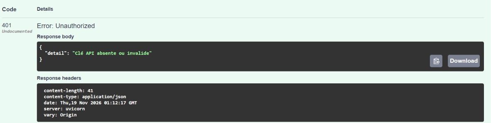
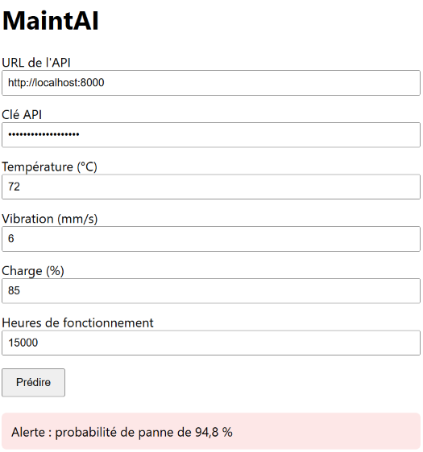
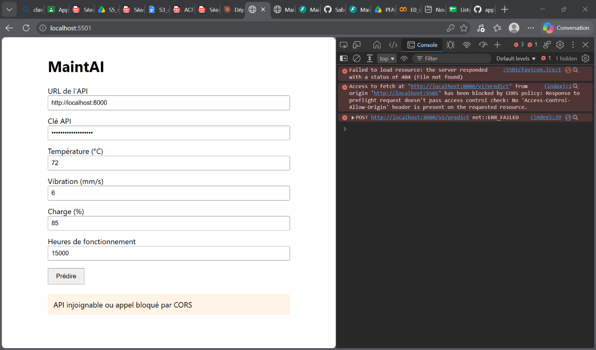
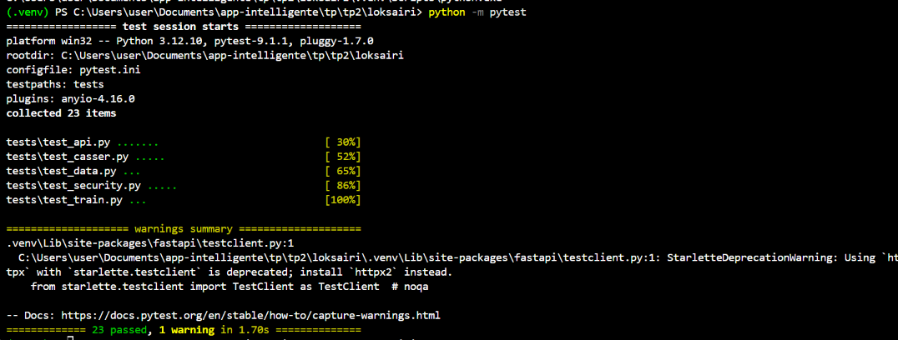

# Compte rendu · TP2 : tester, sécuriser et appeler l'API MaintAI

**Groupe :** Sabrine Loksairi, Aya Haffari, Mohamed Amine Farih, Yasser Rais  ·  **Rédigé par :** Sabrine Loksairi  ·  **Date :** 19/11/2026

---

## 1. Activité 1 : casser son API (dans `TP/TP1`)

Vos cinq requêtes, le code que vous aviez **prévu**, puis le code **obtenu** dans `/docs` :

| Requête | Ce qui ne va pas | Code prévu | Code obtenu |
|---|---|---:|---:|
| `POST /v1/predict` sans `load_pct` | champ manquant | 422 | 422 |
| `POST /v1/predict` avec `"load_pct": 250` | valeur absurde | 422 | 422 |
| `POST /v1/predict` avec `"temperature_c": "chaud"` | texte au lieu d'un nombre | 422 | 422 |
| `POST /v1/predict` avec `"couleur": "rouge"` en plus | champ en trop | 422 | 422 |
| `POST /v1/predicte` avec un relevé valide | mauvaise route | 404 | 404 |

Une de vos prévisions était-elle fausse ? Laquelle, et pourquoi ?

Non, les cinq codes obtenus correspondent aux prévisions. Les quatre premières requêtes atteignent bien la route, mais leur corps ne respecte pas le schéma : FastAPI répond 422. La cinquième vise une route qui n'existe pas : la réponse est 404.

Dernière ligne de `python -m pytest` avec `tests/test_casser.py` (dans `TP/TP1`) :

```
======================== 18 passed, 1 warning in 1.08s =========================
```

À quoi sert `@pytest.mark.parametrize` ? Combien de tests pytest compte-t-il pour votre fonction, et pourquoi ?

`@pytest.mark.parametrize` lance la même fonction de test avec plusieurs jeux de données. pytest compte **5 tests** pour `test_requete_refusee`, car la liste `CAS_REFUSES` contient cinq cas.

## 2. ruff

Sortie de `ruff check .` dans `TP/TP1` :

```
maintai/train.py:58:36: UP017 [*] Use `datetime.UTC` alias
Found 1 error.
[*] 1 fixable with `--fix`.
```

Après `ruff check . --fix` :

```
All checks passed!
```

Quelle différence entre `ruff check .` et `python -m pytest` ? Que vérifie chacun ?

`ruff check .` lit le code sans l'exécuter et signale ce qui est mal écrit, comme un import inutile ou une écriture dépassée. `python -m pytest` exécute le code et vérifie que son comportement correspond aux résultats attendus.

## 3. Mise en place du TP2 (dans `TP/TP2`)

Dernière ligne de `python -m pytest` juste après la mise en place :

```
=================== 2 failed, 16 passed, 1 warning in 1.40s ====================
```

Quels sont les deux tests qui échouent, et que reçoivent-ils au lieu de 401 ?

Les tests `test_missing_key_is_rejected` et `test_wrong_key_is_rejected` échouent. Ils reçoivent un code **200**, car l'API ne vérifie pas encore la clé.

## 4. La clé API (sprint 1)

Votre fonction `require_api_key()` (`maintai/api/security.py`) :

```python
expected = get_settings().api_key
if expected is None:
    raise HTTPException(
        status_code=status.HTTP_500_INTERNAL_SERVER_ERROR,
        detail="La clé API du serveur n'est pas configurée : relancez uvicorn avec --env-file .env",
    )
if x_api_key is None or not secrets.compare_digest(x_api_key.encode(), expected.encode()):
    raise HTTPException(
        status_code=status.HTTP_401_UNAUTHORIZED,
        detail="Clé API absente ou invalide",
    )
```

Votre ligne `router = ...` dans `maintai/api/main.py` :

```python
router = APIRouter(prefix="/v1", dependencies=[Depends(require_api_key)])
```

Après avoir écrit `security.py` seul (sans toucher au router), combien de tests échouent ? Pourquoi ?

**2 tests** échouent encore. La fonction existe, mais aucune route ne l'appelle : les requêtes sans clé continuent donc de recevoir 200.

Dernière ligne de `python -m pytest` à la fin du sprint 1 :

```
======================== 18 passed, 1 warning in 1.14s =========================
```

Lancez `uvicorn maintai.api.main:app --reload --env-file .env`, puis envoyez ces requêtes (avec `/docs` ou `curl.exe`) :

| Requête | Code obtenu | Réponse (le corps JSON) |
|---|---:|---|
| `GET /health`, sans clé | 200 | `{"status":"ok","model_loaded":true}` |
| `POST /v1/predict`, relevé normal, sans clé | 401 | `{"detail":"Clé API absente ou invalide"}` |
| `POST /v1/predict`, relevé normal, fausse clé | 401 | `{"detail":"Clé API absente ou invalide"}` |
| `POST /v1/predict`, relevé normal, bonne clé | 200 | `{"failure_probability":0.9553,"alert":true,"threshold":0.3,"model_version":"2026-11-19T01:01:09Z"}` |
| `POST /v1/predict`, 500 °C, sans clé | 401 | `{"detail":"Clé API absente ou invalide"}` |
| `POST /v1/predict`, 500 °C, bonne clé | 422 | `{"detail":[{"type":"less_than_equal","loc":["body","temperature_c"],"msg":"Input should be less than or equal to 150","input":500,"ctx":{"le":150.0}}]}` |

`model_version` est la date de l'entraînement : cette valeur change à chaque nouvel entraînement.



500 °C sans clé et 500 °C avec la clé ne donnent pas le même code. Pourquoi ?

La clé est contrôlée avant les données. Sans clé, la requête s'arrête au contrôle d'authentification : **401**. Avec la bonne clé, elle passe ce contrôle, puis la température est refusée par le schéma : **422**.

Relancez uvicorn **sans** `--env-file .env` et envoyez un relevé avec votre clé. Quel code obtenez-vous, et pourquoi ce n'est pas 401 ?

J'obtiens **500** avec le message `La clé API du serveur n'est pas configurée : relancez uvicorn avec --env-file .env`. Ce n'est pas un 401, car le client n'a commis aucune erreur : c'est le serveur qui est mal configuré et n'a aucune clé à comparer.

## 5. La page web (sprint 2)

Votre code `fetch` (le contenu du `addEventListener` dans `web/index.html`) :

```javascript
const reading = Object.fromEntries(FEATURES.map(f => [f, Number(document.getElementById(f).value)]));
const url = document.getElementById("url").value.trim().replace(/\/+$/, "");
const cle = document.getElementById("key").value;

try {
  const resp = await fetch(`${url}/v1/predict`, {
    method: "POST",
    headers: { "Content-Type": "application/json", "X-API-Key": cle },
    body: JSON.stringify(reading),
  });
  const data = await resp.json();

  if (!resp.ok) {
    const detail = Array.isArray(data.detail)
      ? data.detail.map(e => `${e.loc.at(-1)} : ${e.msg}`).join(" ; ")
      : data.detail;
    show("err", `Erreur ${resp.status} : ${detail}`);
    return;
  }

  const probabilite = (data.failure_probability * 100).toFixed(1).replace(".", ",");
  if (data.alert) {
    show("alert", `Alerte : probabilité de panne de ${probabilite} %`);
  } else {
    show("ok", `Pas d'alerte : probabilité de panne de ${probabilite} %`);
  }
} catch (e) {
  show("err", "API injoignable ou appel bloqué par CORS");
}
```

Ce qu'affiche la page (servie sur le port 5500) :

| Essai | Ce qu'affiche la page |
|---|---|
| relevé normal, bonne clé | `Alerte : probabilité de panne de 94,8 %` |
| 500 °C, bonne clé | `Erreur 422 : temperature_c : Input should be less than or equal to 150` |
| relevé normal, fausse clé | `Erreur 401 : Clé API absente ou invalide` |



**Expérience CORS.** Servez la page sur le port 5501. Que dit la page, et que dit la console (F12) ?

La page affiche `API injoignable ou appel bloqué par CORS`. La console indique :

```
Access to fetch at 'http://localhost:8000/v1/predict' from origin 'http://localhost:5501' has been blocked by CORS policy: Response to preflight request doesn't pass access control check: No 'Access-Control-Allow-Origin' header is present on the requested resource.
```



Pourquoi `curl.exe` obtient-il une réponse alors que la page du port 5501 est bloquée ?

CORS est une protection appliquée par le navigateur. Avant l'appel, celui-ci demande l'autorisation à l'API avec une requête `OPTIONS`, puis bloque la page si son origine n'est pas autorisée. `curl.exe` n'applique pas cette règle : il envoie directement la requête, et l'API vérifie seulement sa clé.

## 6. Les tests de l'activité 1 dans le TP2

Copiez `test_casser.py` dans `TP/TP2/tests`. Sans `headers=HEADERS`, combien de tests échouent, et avec quel code ? Lequel des cinq cas passe quand même, et pourquoi ?

**4 tests** échouent : ils attendent 422, mais reçoivent **401**, car la clé est vérifiée avant les données. Le cas **mauvaise route** passe quand même : `/v1/predicte` n'existe pas, donc l'API répond 404 sans exécuter le contrôle de la clé.

Dernière ligne de `python -m pytest` avec `headers=HEADERS` :

```
======================== 23 passed, 1 warning in 1.22s =========================
```



## 7. Questions de compréhension

1. Quelle différence entre 401 et 422 ? Et entre 401 et 403 ?
   401 signifie que le client n'est pas authentifié : sa clé est absente ou fausse. 422 signifie que le client est passé, mais que ses données sont invalides. 403 signifie que le client est bien identifié, mais qu'il n'a pas le droit d'effectuer cette action.
2. Pourquoi la clé n'est-elle ni dans le code ni dans Git ? Que contiennent `.env` et `.env.example`, et lequel est commité ?
   Une clé commitée reste dans l'historique de Git, même après sa suppression. `.env` contient la vraie clé et n'est jamais commité. `.env.example` contient une fausse valeur qui indique quoi configurer : c'est lui qui est commité.
3. Pourquoi la clé voyage-t-elle dans un en-tête et pas dans l'URL ?
   Une URL est enregistrée dans les journaux du serveur et l'historique du navigateur. La clé y serait donc exposée.
4. Que fait `secrets.compare_digest` de plus qu'un simple `==` ?
   Elle compare les valeurs en un temps qui ne dépend pas de la position de la première différence. La durée de la réponse ne révèle donc pas combien de caractères sont corrects.
5. Qu'est-ce qu'une « origine » ? `http://localhost:5500` et `http://localhost:8000` sont-elles la même origine ?
   Une origine est composée d'un schéma, d'un domaine et d'un port. Ces deux adresses sont des origines différentes, car leurs ports sont différents.

## 8. Le rendu Git

- Lien de la pull request : https://github.com/Sabrineloksairi/app-intelligente/pull/2
- Le tag `tp2` existe sur GitHub : oui, créé sur `main` juste après la fusion de la pull request #2
- `git status` avant le commit : le fichier `.env` apparaissait-il ? non
- Qui a relu la pull request, et quel commentaire a-t-il laissé ?
  Aya Haffari l'a relue et approuvée. Son commentaire : « Tests lancés sur mon PC (après `python -m maintai.dataset` et `python -m maintai.train`) : 23 passed. Aucun `.venv`, dossier `models`, fichier `.csv` ni `.env` dans Files changed (seulement `.env.example`). `docs/adr/003-securite.md` justifie l'en-tête `X-API-Key` et la liste explicite d'origines CORS. `COMPTE_RENDU.md` est rempli. »

## 9. Ce qui reste flou

Je dois encore approfondir la façon de changer une clé API sans interrompre les programmes qui l'utilisent. Je me demande aussi comment donner des droits différents à chaque client, puisque le TP2 utilise une seule clé pour tous.
