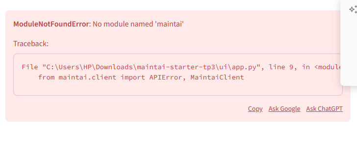
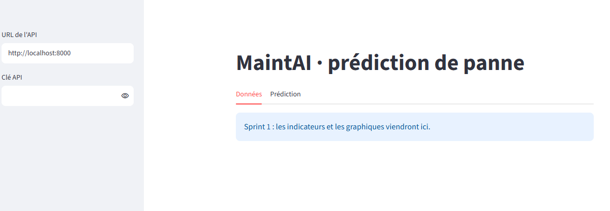
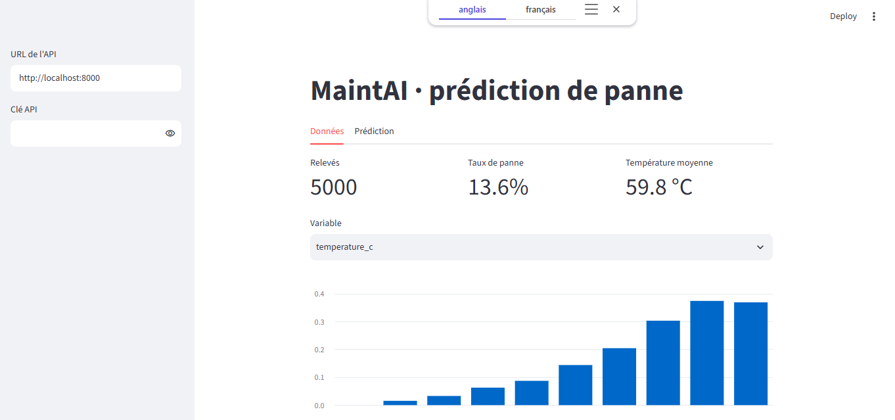
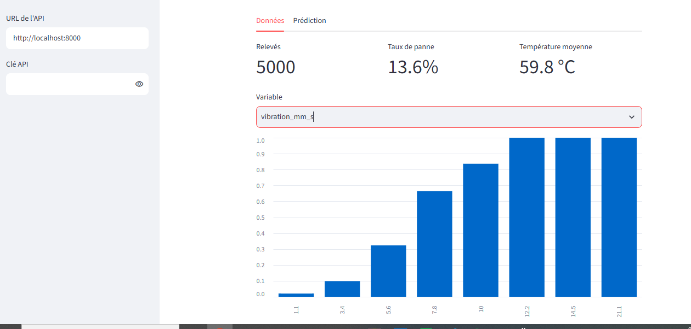
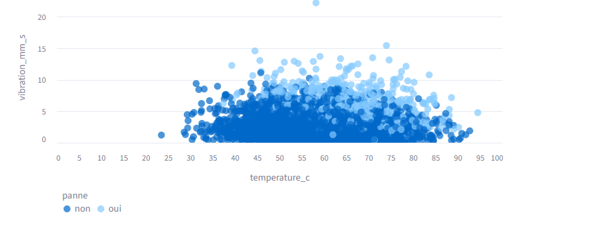
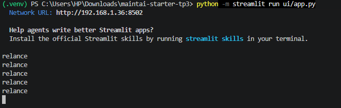
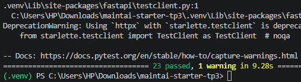
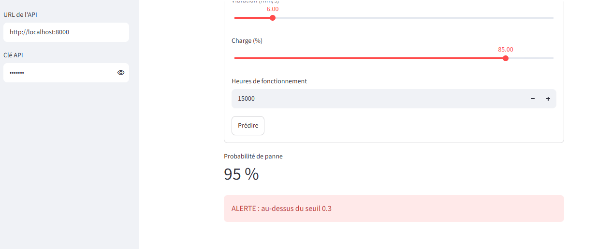
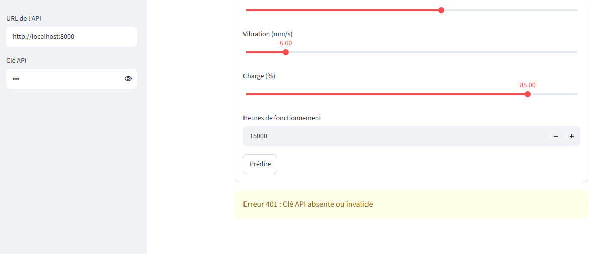
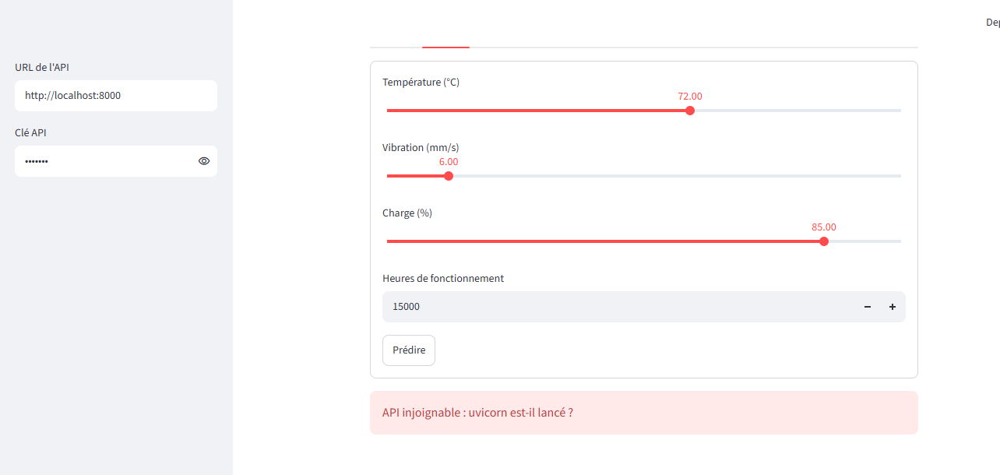

# Compte rendu · TP3 : une interface Streamlit pour MaintAI

**Groupe :** G1 5IA  ·  **Membres :** Aya Haffari  ·  **Date :** 12/11/2026

---

## 1. Mise en place (dans `TP/TP3`)

Dernière ligne de `python -m pytest` juste après la mise en place :

```
5 failed, 18 passed
```

Quels fichiers de tests échouent, et quelle erreur donnent-ils ?

`tests/test_ui.py` (2 tests) et `tests/test_client.py` (3 tests) échouent. Dans `test_client.py`, `MaintaiClient.predict` lève `NotImplementedError` car son corps n'est pas encore écrit. Dans `test_ui.py`, la page n'affiche pas encore d'indicateur (`at.metric[0]` n'existe pas) ni de résultat de prédiction. Les 18 autres tests (TP1 et TP2 : données, entraînement, API, sécurité) passent.

## 2. Lancer Streamlit

Lancez d'abord `streamlit run ui/app.py`. Que s'affiche-t-il dans le navigateur ?

```
ModuleNotFoundError: No module named 'maintai'
```



Lancez ensuite `python -m streamlit run ui/app.py`. Pourquoi cette commande fonctionne-t-elle et pas la première ?

Python cherche les modules dans une liste de dossiers (`sys.path`) qui dépend de la façon de lancer. Avec `streamlit run ui/app.py`, le premier dossier est celui du script (`TP3/ui/`) : le dossier `maintai/` n'y est pas, donc l'import échoue. Avec `python -m streamlit ...`, Python ajoute le dossier courant (`TP3/`) à la liste : `maintai/` y est, l'import réussit.



## 3. Sprint 1 : l'onglet « Données »

Votre code de l'onglet « Données » (de `c1, c2, c3 = ...` jusqu'au nuage de points) :

```python
# 1. Trois indicateurs côte à côte
c1, c2, c3 = st.columns(3)
c1.metric("Relevés", len(df))
c2.metric("Taux de panne", f"{df.failure.mean():.1%}")
c3.metric("Température moyenne", f"{df.temperature_c.mean():.1f} °C")

# 2. Liste déroulante pour choisir une variable
variable = st.selectbox("Variable", FEATURES)

# 3. Taux de panne par tranche, en barres
tranches = pd.cut(df[variable], bins=10)
taux = df.groupby(tranches, observed=True).failure.mean()
taux.index = [round(i.mid, 1) for i in taux.index]
st.bar_chart(taux)

# 4. Nuage de points température / vibration, coloré selon la panne
nuage = df.assign(panne=df.failure.map({0: "non", 1: "oui"}))
st.scatter_chart(nuage, x="temperature_c", y="vibration_mm_s", color="panne")
```

| Indicateur | Valeur affichée |
|---|---|
| Relevés | 5000 |
| Taux de panne | 13.6 % |
| Température moyenne | 59.8 °C |



Choisissez `vibration_mm_s` dans la liste. Comment évolue le taux de panne quand la vibration augmente ?

Le taux de panne reste très faible pour les petites vibrations (environ 0.02 vers 1 mm/s et 0.10 vers 3 mm/s), puis augmente très vite : environ 0.32 vers 6 mm/s, 0.66 vers 8 mm/s, 0.84 vers 10 mm/s, et il atteint 1.0 (100 % de pannes) à partir de 12 mm/s. En choisissant `temperature_c`, le taux monte beaucoup plus lentement avec la température et ne dépasse pas environ 0.37. La vibration est donc la variable qui compte le plus ici.





Ajoutez un `print("relance")` en haut de `ui/app.py`, puis déplacez un curseur. Que voyez-vous dans le terminal, et qu'est-ce que cela montre sur le fonctionnement de Streamlit ?

Le mot « relance » s'affiche dans le terminal à chaque interaction avec un widget (changement de variable dans la liste, etc.). Cela montre que Streamlit réexécute tout le script `ui/app.py` de la première à la dernière ligne à chaque interaction. Les curseurs du formulaire (`st.form`) ne relancent rien tant qu'on n'a pas cliqué sur « Prédire ».



À quoi sert `@st.cache_data` sur la fonction `charger` ?

Comme le script est relancé à chaque clic, sans cache le CSV serait relu depuis le disque à chaque fois. Avec `@st.cache_data`, il n'est lu qu'une seule fois : les relances suivantes réutilisent le tableau gardé en mémoire, et la page reste rapide.

## 4. Sprint 2 : l'onglet « Prédiction »

Votre méthode `predict` (`maintai/client.py`) :

```python
def predict(self, reading: dict) -> dict:
    """Envoie un relevé ; lève APIError si l'API refuse, httpx.HTTPError si elle est injoignable."""
    headers = {"X-API-Key": self.api_key} if self.api_key else {}
    r = self.http.post("/v1/predict", json=reading, headers=headers)
    if r.status_code != 200:
        raise APIError(r.status_code, r.json().get("detail"))
    return r.json()
```

Et le bloc `if envoye:` de `ui/app.py` :

```python
if envoye:
    try:
        res = MaintaiClient(url, api_key=cle).predict(releve)
    except APIError as e:
        st.warning(f"Erreur {e.status_code} : {e.detail}")
    except httpx.HTTPError:
        st.error("API injoignable : uvicorn est-il lancé ?")
    else:
        pct = round(res["failure_probability"] * 100)
        st.metric("Probabilité de panne", f"{pct} %")
        if res["alert"]:
            st.error(f"ALERTE : au-dessus du seuil {res['threshold']}")
        else:
            st.success("Situation normale")
```

Dernière ligne de `python -m pytest` à la fin du sprint 2 :

```
23 passed
```



Avec l'API lancée (`uvicorn maintai.api.main:app --reload --env-file .env`) :

| Essai | Ce qu'affiche Streamlit |
|---|---|
| valeurs par défaut, bonne clé | Probabilité de panne : 95 % et un encadré rouge « ALERTE : au-dessus du seuil 0.3 » |
| valeurs par défaut, fausse clé | Un encadré jaune « Erreur 401 : Clé API absente ou invalide » |
| API arrêtée (Ctrl+C dans le terminal d'uvicorn) | Un encadré rouge « API injoignable : uvicorn est-il lancé ? » |

**Essai 1 : bonne clé** (95 % et alerte)



**Essai 2 : fausse clé** (erreur 401)



**Essai 3 : API arrêtée**



Le port 8501 n'est pas dans `MAINTAI_CORS_ORIGINS`, et pourtant la prédiction fonctionne. Pourquoi ?

CORS est une règle appliquée par le navigateur. Dans la page HTML du TP2, c'est le navigateur qui exécute `fetch(...)` : il envoie une requête de permission (OPTIONS avec l'en-tête `Origin`) et bloque la réponse si l'origine n'est pas dans la liste de l'API. Dans Streamlit, le navigateur n'appelle jamais l'API : il affiche seulement la page. C'est le serveur Streamlit, un programme Python, qui envoie la requête via `httpx`, sans en-tête `Origin` ni contrôle CORS (comme `curl` ou le programme Java). La clé API reste vérifiée par l'API, et c'est elle qui protège l'accès.

## 5. Questions de compréhension

1. Dans la page web du TP2, qui envoie la requête à l'API ? Et dans Streamlit ?

   Dans la page du TP2, c'est le navigateur de l'utilisateur (via le JavaScript `fetch`). Dans Streamlit, c'est le serveur Streamlit (Python, avec `MaintaiClient` et `httpx`) ; le navigateur ne parle qu'à Streamlit.

2. Pourquoi les tests de `test_client.py` n'ont-ils pas besoin d'uvicorn ?

   Parce que `MaintaiClient` accepte un client HTTP en paramètre (`http=client`). Les tests lui passent le `TestClient` de FastAPI, qui envoie la requête directement à l'application en mémoire, sans réseau ni serveur. Le code testé est le même, seul le transport change.

3. Page HTML + JavaScript (TP2) ou Streamlit (TP3) : laquelle choisiriez-vous pour une démonstration à un client ? Et pour l'application d'un technicien de maintenance ? Pourquoi ?

   Pour une démonstration à un client, je choisirais la page HTML + JavaScript : l'apparence est entièrement personnalisable et elle donne une image plus « produit », mais elle demande du JavaScript et la gestion de CORS. Pour l'outil d'un technicien, je choisirais Streamlit : il se construit en quelques heures en Python (graphiques et formulaires inclus), il n'y a pas de CORS à gérer, et l'apparence compte moins que la rapidité de mise en place.

## 6. Le rendu Git

- Lien de la pull request : https://github.com/Sabrineloksairi/app-intelligente/pull/3 (PR commune du groupe pour le TP3, branche `tp3`)
- Le tag `tp3` existe sur GitHub : oui (créé par Sabrine Loksairi après la fusion de la PR)
- PR relue par : Sabrine Loksairi (relecture de `tp/tp3/haffari`, puis approbation)
- Réciproquement, j'ai relu `tp/tp3/loksairi` : 23 passed (dataset, entraînement et tests lancés), aucun `.env`, modèle ni CSV, puis approbation de la PR #3
- `git status` avant le commit : `.env`, `data/` ou `models/` apparaissaient-ils ? non (ils sont exclus par le `.gitignore`)

## 7. Ce qui reste flou

Ce qui reste flou pour moi, c'est la gestion des environnements virtuels (`.venv`) : j'ai eu du mal à savoir lequel était activé et pourquoi la version de Python devait être compatible avec les bibliothèques. Je ne suis pas non plus complètement sûre de la différence entre arrêter un `uvicorn --reload` avec Ctrl+C et le fait qu'un sous-processus puisse continuer à répondre sur le port 8000.
