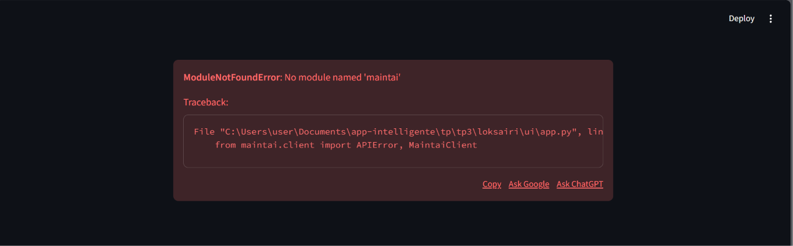
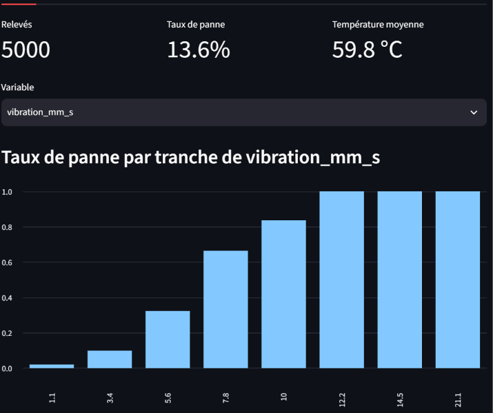
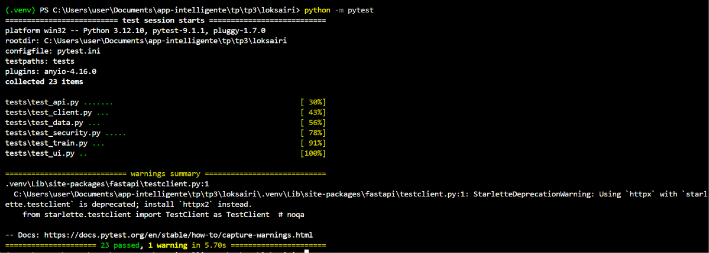
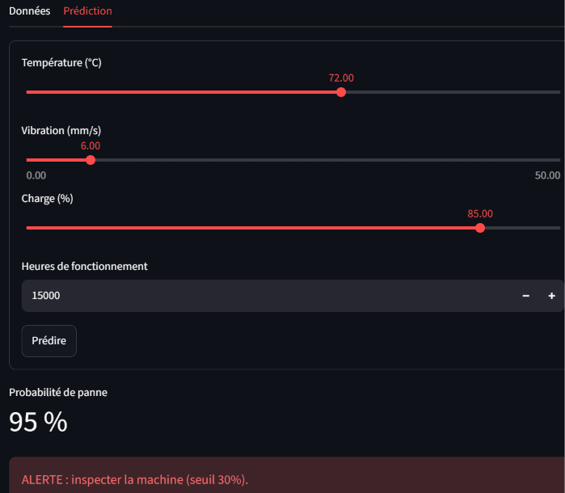

# Compte rendu · TP3 : une interface Streamlit pour MaintAI

**Groupe :** Sabrine Loksairi, Aya Haffari, Mohamed Amine Farih, Yasser Rais  ·  **Rédigé par :** Sabrine Loksairi  ·  **Date :** 19/11/2026

---

## 1. Mise en place (dans `TP/TP3`)

Dernière ligne de `python -m pytest` juste après la mise en place :

```
=================== 5 failed, 18 passed, 1 warning in 2.34s ====================
```

Quels fichiers de tests échouent, et quelle erreur donnent-ils ?

- `tests/test_client.py` : ses 3 tests échouent avec `NotImplementedError: TP3 sprint 2 : MaintaiClient.predict`, car la méthode `predict` du client n'est pas encore écrite.
- `tests/test_ui.py` : ses 2 tests échouent avec `IndexError: list index out of range`. Les tests lisent les indicateurs `st.metric` de la page, mais la page n'en affiche encore aucun.

## 2. Lancer Streamlit

Lancez d'abord `streamlit run ui/app.py`. Que s'affiche-t-il dans le navigateur ?

```
ModuleNotFoundError: No module named 'maintai'
Traceback:
File "...\ui\app.py", line 9, in <module>
    from maintai.client import APIError, MaintaiClient
```



Lancez ensuite `python -m streamlit run ui/app.py`. Pourquoi cette commande fonctionne-t-elle et pas la première ?

Python cherche les modules dans une liste de dossiers. Avec `streamlit run`, cette liste contient le dossier du script, `ui/`, mais pas la racine du projet : le dossier `maintai/` est donc introuvable. Avec `python -m`, Python ajoute en plus le dossier courant, c'est-à-dire la racine du projet, où se trouve `maintai/`.

## 3. Sprint 1 : l'onglet « Données »

Votre code de l'onglet « Données » (de `c1, c2, c3 = ...` jusqu'au nuage de points) :

```python
c1, c2, c3 = st.columns(3)
c1.metric("Relevés", len(df))
c2.metric("Taux de panne", f"{df.failure.mean():.1%}")
c3.metric("Température moyenne", f"{df.temperature_c.mean():.1f} °C")

variable = st.selectbox("Variable", FEATURES)
tranches = pd.cut(df[variable], bins=10)
taux = df.groupby(tranches, observed=True).failure.mean()
taux.index = [round(t.mid, 1) for t in taux.index]
st.subheader(f"Taux de panne par tranche de {variable}")
st.bar_chart(taux)

st.subheader("Température et vibration")
nuage = df.assign(panne=df.failure.map({0: "non", 1: "oui"}))
st.scatter_chart(nuage, x="temperature_c", y="vibration_mm_s", color="panne")
```

| Indicateur | Valeur affichée |
|---|---|
| Relevés | 5000 |
| Taux de panne | 13.6% |
| Température moyenne | 59.8 °C |

Dernière ligne de `python -m pytest` à la fin du sprint 1 :

```
=================== 4 failed, 19 passed, 1 warning in 2.40s ====================
```

Choisissez `vibration_mm_s` dans la liste. Comment évolue le taux de panne quand la vibration augmente ?

Il augmente très fortement : environ 2 % autour de 1 mm/s, 32 % autour de 5,6 mm/s, 66 % autour de 7,8 mm/s, puis 100 % au-delà de 12 mm/s. Avec la température, le taux ne dépasse pas 37 % : **la vibration est la variable qui compte le plus**. Deux tranches de vibration n'ont aucune barre, car aucun relevé n'y tombe.



Ajoutez un `print("relance")` en haut de `ui/app.py`, puis déplacez un curseur. Que voyez-vous dans le terminal, et qu'est-ce que cela montre sur le fonctionnement de Streamlit ?

Le terminal affiche une nouvelle ligne `relance` à chaque action sur la page : changement de variable, saisie de la clé, clic sur un onglet ou sur « Prédire ». Cela montre que Streamlit réexécute tout le script `ui/app.py`, de la première à la dernière ligne, à chaque interaction. Les curseurs placés dans le formulaire ne relancent rien tant qu'on ne clique pas sur « Prédire ».

À quoi sert `@st.cache_data` sur la fonction `charger` ?

Comme tout le script est relancé à chaque clic, le CSV serait relu à chaque fois. `@st.cache_data` garde le résultat du premier appel en mémoire : le fichier n'est lu qu'une fois, et la page reste rapide.

## 4. Sprint 2 : l'onglet « Prédiction »

Votre méthode `predict` (`maintai/client.py`) :

```python
def predict(self, reading: dict) -> dict:
    """Envoie un relevé ; lève APIError si l'API refuse, httpx.HTTPError si elle est injoignable."""
    headers = {"X-API-Key": self.api_key} if self.api_key else {}
    r = self.http.post("/v1/predict", json=reading, headers=headers)
    if r.status_code != 200:
        try:
            detail = r.json().get("detail")
        except ValueError:
            detail = r.text
        raise APIError(r.status_code, detail)
    return r.json()
```

Le code sous `if envoye:` dans `ui/app.py` :

```python
try:
    resultat = MaintaiClient(url, api_key=cle).predict(releve)
except APIError as e:
    st.warning(f"Erreur {e.status_code} : {e.detail}")
except httpx.HTTPError:
    st.error(f"API injoignable à l'adresse {url} : vérifiez qu'uvicorn est lancé.")
else:
    pct = round(resultat["failure_probability"] * 100)
    st.metric("Probabilité de panne", f"{pct} %")
    if resultat["alert"]:
        st.error(f"ALERTE : inspecter la machine (seuil {resultat['threshold']:.0%}).")
    else:
        st.success(f"Fonctionnement normal (seuil {resultat['threshold']:.0%}).")
```

Dernière ligne de `python -m pytest` à la fin du sprint 2 :

```
======================== 23 passed, 1 warning in 1.77s =========================
```



Avec l'API lancée (`uvicorn maintai.api.main:app --reload --env-file .env`) :

| Essai | Ce qu'affiche Streamlit |
|---|---|
| valeurs par défaut, bonne clé | `Probabilité de panne : 95 %`, puis en rouge `ALERTE : inspecter la machine (seuil 30%).` |
| valeurs par défaut, fausse clé | En jaune : `Erreur 401 : Clé API absente ou invalide` |
| API arrêtée (Ctrl+C dans le terminal d'uvicorn) | En rouge : `API injoignable à l'adresse http://localhost:8000 : vérifiez qu'uvicorn est lancé.` |



Le port 8501 n'est pas dans `MAINTAI_CORS_ORIGINS`, et pourtant la prédiction fonctionne. Pourquoi ?

CORS est une règle appliquée par le navigateur au JavaScript d'une page. Ici, le navigateur ne parle qu'au serveur Streamlit. C'est le programme Python de Streamlit qui appelle l'API avec `httpx`, comme `curl.exe` au TP2 : le navigateur n'intervient pas dans cet appel, donc CORS ne s'applique pas. La clé API reste en revanche vérifiée.

## 5. Questions de compréhension

1. Dans la page web du TP2, qui envoie la requête à l'API ? Et dans Streamlit ?
   Au TP2, c'est le navigateur qui envoie la requête, avec le `fetch` de la page. Avec Streamlit, c'est le serveur Streamlit, en Python, qui l'envoie avec `MaintaiClient` ; le navigateur affiche seulement le résultat.
2. Pourquoi les tests de `test_client.py` n'ont-ils pas besoin d'uvicorn ?
   Ils donnent à `MaintaiClient` le `TestClient` de FastAPI dans le paramètre `http`. Les requêtes vont directement à l'application, dans le même programme, sans passer par le réseau : aucun serveur n'est nécessaire.
3. Page HTML + JavaScript (TP2) ou Streamlit (TP3) : laquelle choisiriez-vous pour une démonstration à un client ? Et pour l'application d'un technicien de maintenance ? Pourquoi ?
   Pour une démonstration, je choisirais **Streamlit** : en quelques lignes de Python, on montre les données, des graphiques et une prédiction, sans écrire de JavaScript. Pour l'application d'un technicien, je choisirais **la page HTML + JavaScript** : elle est légère, s'adapte à son téléphone ou à sa tablette, se personnalise librement et ne demande pas de garder un serveur Python ouvert pour chaque utilisateur. On renonce alors à la rapidité de développement de Streamlit.

## 6. Le rendu Git

- Lien de la pull request : https://github.com/Sabrineloksairi/app-intelligente/pull/3
- Le tag `tp3` existe sur GitHub : oui, créé sur `main` juste après la fusion de la pull request #3
- `git status` avant le commit : `.env`, `data/` ou `models/` apparaissaient-ils ? non
- Relecture : Aya Haffari a relu et approuvé mon dossier. Son commentaire : « Relecture du dossier tp/tp3/loksairi : tests lancés (23 passed), dataset et entraînement OK, client.py et ui/app.py relus, captures présentes, aucun .env, modèle ni CSV. Approuvé. » J'ai relu son dossier `tp/tp3/haffari` sur la même pull request (23 passed).

## 7. Ce qui reste flou

Je dois encore comprendre comment garder un résultat affiché après un autre clic, puisque `envoye` ne vaut `True` que pendant la relance provoquée par le bouton. Je me demande aussi comment déployer cette interface pour plusieurs techniciens sans que chacun lance Streamlit sur son PC.
