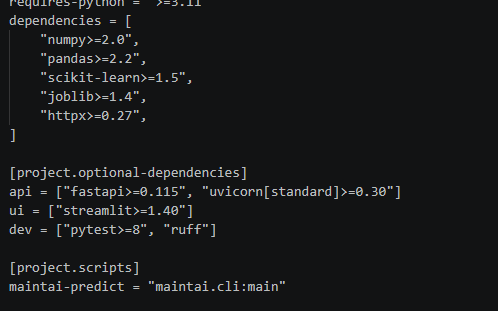
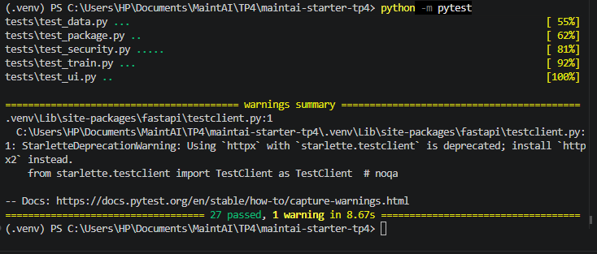
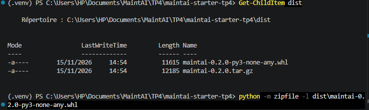
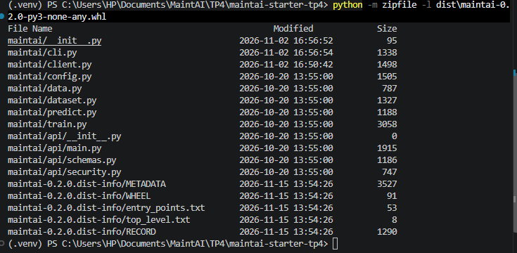
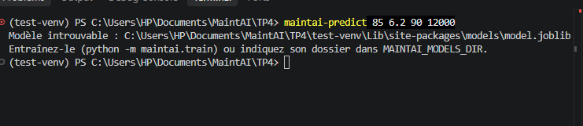
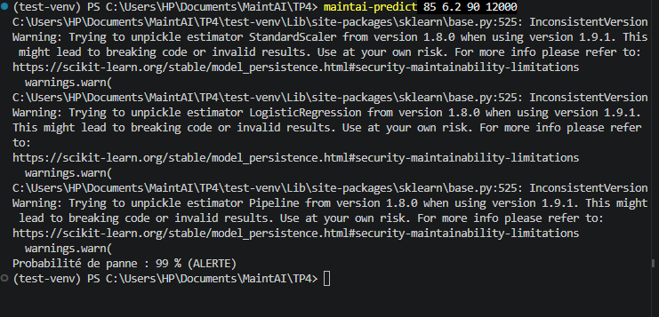
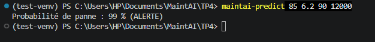

# Compte rendu · TP4 : MaintAI devient un package Python

**Groupe :** G1 5IA  ·  **Membres :** Aya Haffari  ·  **Date :** 15/11/2026

---

## 1. Mise en place (dans `TP/TP4`, avec son propre `.venv`)

Dernière ligne de `python -m pytest` juste après `pip install -r requirements.txt` :

```
2 failed, 25 passed
```

Quels sont les deux tests qui échouent, et pourquoi ?

Les deux sont dans `tests/test_package.py` : `test_installed_version_matches_the_code` et `test_command_is_declared`. Ils échouent parce que `maintai` n'est pas encore installé comme package : pip ne connaît ni son nom et sa version (`importlib.metadata.version("maintai")` échoue), ni la commande `maintai-predict` dans les `console_scripts`. Les 25 autres tests passent car `pytest.ini` ajoute le dossier du projet au chemin de recherche de Python.

## 2. Sprint 1 : `pyproject.toml` et `pip install -e .`

Vos sections `dependencies` et `[project.scripts]` :

```toml
dependencies = [
    "numpy>=2.0",
    "pandas>=2.2",
    "scikit-learn>=1.5",
    "joblib>=1.4",
    "httpx>=0.27",
]

[project.scripts]
maintai-predict = "maintai.cli:main"
```



Pourquoi `pytest` et `fastapi` ne sont-ils pas dans `dependencies` ?

`dependencies` ne contient que ce dont le code du package a besoin pour fonctionner partout, y compris la commande `maintai-predict` qui n'a pas besoin d'API. `pytest` ne sert qu'aux développeurs (groupe `dev`), `fastapi` et `uvicorn` qu'à ceux qui lancent l'API (groupe `api`), `streamlit` qu'à l'interface (groupe `ui`). Ils s'installent à la demande : `pip install -e ".[api,dev]"`. Ainsi, un collègue qui veut seulement la commande n'installe pas tout.

Sortie de `pip show maintai` (les quatre premières lignes) :

```
Name: maintai
Version: 0.2.0
Summary: Prédiction de panne à partir de relevés de capteurs
Home-page:
```

Dernière ligne de `python -m pytest` à la fin du sprint 1 :

```
27 passed
```



Placez-vous dans un autre dossier (`cd %TEMP%`) et lancez `maintai-predict 72 6 85 15000`, puis `python -c "import maintai; print(maintai.__file__)"`. Qu'affichent ces deux commandes ? Où Python trouve-t-il le code de `maintai` ?

```
Probabilité de panne : 95 % (ALERTE)
C:\Users\HP\Documents\MaintAI\TP4\maintai-starter-tp4\maintai\__init__.py
```

La commande fonctionne depuis n'importe quel dossier et `maintai.__file__` pointe vers le dossier `TP4\maintai-starter-tp4\maintai\` du projet : l'installation éditable a posé dans `.venv\Lib\site-packages` un petit fichier (`__editable__.maintai-0.2.0.pth`) qui est un lien vers mon dossier de travail. Python trouve donc le code là où je l'édite, et pas dans une copie.

Modifiez le message affiché par `maintai/cli.py`, puis relancez `maintai-predict` sans réinstaller. Le changement est-il visible ? Pourquoi ?

J'ai remplacé « Probabilité » par « Risque » dans `cli.py`. Sans réinstaller, `maintai-predict 72 6 85 15000` a affiché `Risque de panne : 95 % (ALERTE)`. Et `pytest` a alors donné `1 failed, 26 passed` : `test_cli.py` cherche la phrase « Probabilité de panne », donc les tests ont détecté ma modification. Après avoir remis le texte d'origine : `27 passed`.

Le changement est visible tout de suite, sans réinstaller. En mode éditable, pip ne copie pas le code : il crée un lien vers `maintai-starter-tp4\maintai\`. Chaque modification du fichier est donc prise en compte au lancement suivant. (Seule une modification de `pyproject.toml`, comme une nouvelle commande, demande de relancer `pip install -e .`.)

## 3. Sprint 2 : construire et installer le wheel

Sortie de `dir dist` après `python -m build` :

```
maintai-0.2.0-py3-none-any.whl     (environ 11 Ko)
maintai-0.2.0.tar.gz               (environ 12 Ko)
```



Contenu du wheel (`tar -tf dist\maintai-0.2.0-py3-none-any.whl`). Le modèle, les tests et `ui/` y sont-ils ? Pourquoi ?

```
maintai/__init__.py
maintai/cli.py
maintai/client.py
maintai/config.py
maintai/data.py
maintai/dataset.py
maintai/predict.py
maintai/train.py
maintai/api/__init__.py
maintai/api/main.py
maintai/api/schemas.py
maintai/api/security.py
maintai-0.2.0.dist-info/METADATA
maintai-0.2.0.dist-info/WHEEL
maintai-0.2.0.dist-info/entry_points.txt
maintai-0.2.0.dist-info/top_level.txt
maintai-0.2.0.dist-info/RECORD
```



Non : ni le modèle (`models/`), ni les tests (`tests/`), ni l'interface (`ui/`) ne sont dans le wheel. La section `[tool.setuptools.packages.find]` avec `include = ["maintai*"]` limite le package au dossier `maintai/`. Le modèle est de plus un fichier de données produit par l'entraînement, pas du code : il se livre à part.

Dans un environnement neuf (`TP4\test-venv`, créé avec Python 3.12), installez le wheel et lancez `maintai-predict` :

| Étape | Ce qui s'affiche |
|---|---|
| sans `MAINTAI_MODELS_DIR` | `Modèle introuvable : ...\test-venv\Lib\site-packages\models\model.joblib`, puis « Entraînez-le (python -m maintai.train) ou indiquez son dossier dans MAINTAI_MODELS_DIR. » |
| avec `MAINTAI_MODELS_DIR` vers vos `models` (relevé `85 6.2 90 12000`) | « Probabilité de panne : 99 % (ALERTE) », mais précédée de trois `InconsistentVersionWarning` (le modèle a été écrit avec scikit-learn 1.8.0 et l'environnement neuf a installé la 1.9.1) |
| après `pip install scikit-learn==1.8.0` | « Probabilité de panne : 99 % (ALERTE) » seulement, sans avertissement |

Sans `MAINTAI_MODELS_DIR` :



Avec `MAINTAI_MODELS_DIR` (scikit-learn 1.9.1) :



Après `pip install scikit-learn==1.8.0` :



D'où vient l'avertissement `InconsistentVersionWarning` ? Quelle ligne de `models/model_info.json` permet de le comprendre ?

Le modèle est un objet scikit-learn sauvegardé avec joblib : il n'est garanti de se relire correctement qu'avec la version de scikit-learn qui l'a écrit. Le wheel n'impose que `scikit-learn>=1.5` : pip a installé la dernière version, différente de celle de l'entraînement. La ligne `"sklearn_version": "1.8.0"` de `models/model_info.json` donne la version exacte avec laquelle le modèle a été créé.

## 4. Questions de compréhension

1. Quelle différence entre `requirements.txt` et la liste `dependencies` de `pyproject.toml` ?

   `dependencies` dit « au moins » (`>=`) : un package doit pouvoir s'installer à côté d'autres bibliothèques sans imposer de version précise. `requirements.txt` dit « exactement » (`==`) : il fige les versions pour reproduire l'environnement, ce qui est nécessaire pour relire le modèle avec la version qui l'a écrit.

2. Quelle différence entre `pip install -e .` et `pip install dist\maintai-0.2.0-py3-none-any.whl` ?

   `pip install -e .` (éditable) crée un lien vers mon dossier de travail : les modifications sont visibles immédiatement, c'est pour développer. Installer le wheel copie le code dans `site-packages` : c'est une copie figée à la version 0.2.0, qui ne change plus si je modifie le projet, c'est pour livrer à quelqu'un d'autre.

3. Qu'est-ce qu'un « point d'entrée » (`[project.scripts]`) ? Où pip crée-t-il le fichier `maintai-predict.exe` ?

   C'est une ligne `nom-de-la-commande = "module:fonction"` qui dit à pip quelle fonction Python appeler quand on tape la commande (ici `main` de `maintai/cli.py`). À l'installation, pip crée un petit exécutable `maintai-predict.exe` dans le dossier `.venv\Scripts` de l'environnement.

## 5. Le rendu Git

- Lien de la pull request : https://github.com/Sabrineloksairi/app-intelligente/pull/4 (PR commune du groupe pour le TP4, branche `tp4`)
- Le tag `tp4` existe sur GitHub : oui (créé par Sabrine Loksairi après la fusion de la PR)
- PR relue par : Sabrine Loksairi (relecture de `tp/tp4/haffari`, puis approbation)
- `git status` avant le commit : `dist/`, `build/` ou `maintai.egg-info/` apparaissaient-ils ? non (exclus par le `.gitignore` du starter)

## 6. Ce qui reste flou

Ce qui m'a surpris, c'est que la commande `maintai-predict` marchait très bien avec `pip install -e .` alors que mon premier wheel ne contenait pas `maintai/cli.py` : l'installation éditable lit mon dossier directement et cache ce défaut. Je l'ai vu en listant le contenu du wheel, et il a fallu supprimer l'ancien dossier `build\` avant de reconstruire. Ce qui reste un peu flou, c'est comment choisir entre `>=` et `==` pour les versions : je comprends qu'un package garde `>=` pour rester souple, mais je ne sais pas encore comment la version du modèle serait imposée à l'utilisateur en vrai projet.
