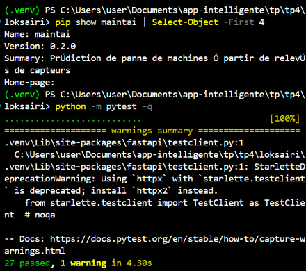
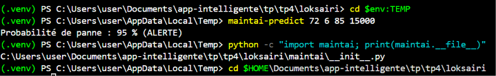
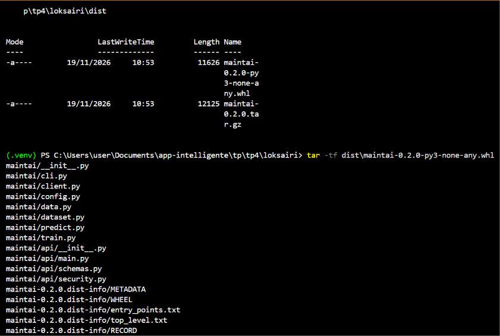
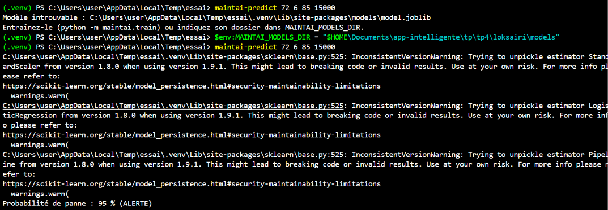
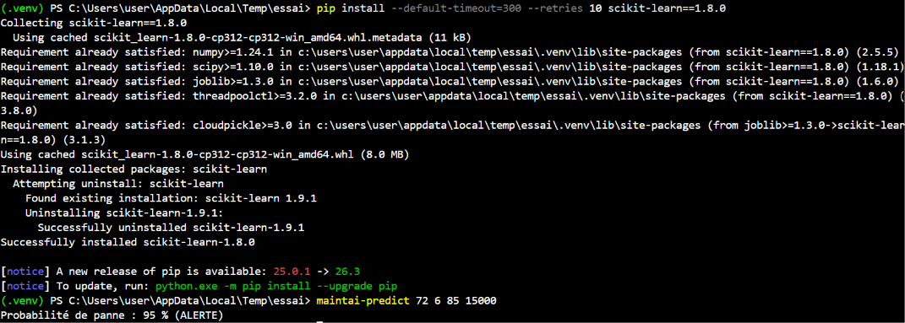

# Compte rendu · TP4 : MaintAI devient un package Python

**Groupe :** Sabrine Loksairi, Aya Haffari, Mohamed Amine Farih, Yasser Rais  ·  **Rédigé par :** Sabrine Loksairi  ·  **Date :** 19/11/2026

---

## 1. Mise en place (dans `TP/TP4`, avec son propre `.venv`)

Dernière ligne de `python -m pytest` juste après `pip install -r requirements.txt` :

```
=================== 2 failed, 25 passed, 1 warning in 3.36s ====================
```

Quels sont les deux tests qui échouent, et pourquoi ?

Les deux tests de `tests/test_package.py` :

- `test_installed_version_matches_the_code` : `importlib.metadata` ne trouve aucun package nommé `maintai`, car il n'est pas encore installé.
- `test_command_is_declared` : la commande `maintai-predict` n'apparaît pas dans les points d'entrée, car `[project.scripts]` n'est pas écrit et rien n'est installé.

Le code fonctionne déjà avec `python -m`, mais Python ne le connaît pas encore comme un package installé.

## 2. Sprint 1 : `pyproject.toml` et `pip install -e .`

Vos sections `dependencies` et `[project.scripts]` :

```toml
dependencies = [
    "numpy>=1.26",          # dataset.py
    "pandas>=2.2",          # data.py, dataset.py
    "scikit-learn>=1.5",    # data.py, train.py, predict.py
    "joblib>=1.3",          # train.py, predict.py
    "httpx>=0.27",          # client.py
]

[project.scripts]
maintai-predict = "maintai.cli:main"
```

Pourquoi `pytest` et `fastapi` ne sont-ils pas dans `dependencies` ?

`dependencies` contient seulement ce dont le code a besoin pour fonctionner chez n'importe quel utilisateur. `pytest` ne sert qu'à tester, et `fastapi` qu'à lancer l'API : ils sont dans les groupes optionnels `dev` et `api`. Un collègue qui veut seulement `maintai-predict` n'a donc pas à les installer.

Sortie de `pip show maintai` (les quatre premières lignes) :

```
Name: maintai
Version: 0.2.0
Summary: Prédiction de panne de machines à partir de relevés de capteurs
Home-page:
```

Dernière ligne de `python -m pytest` à la fin du sprint 1 :

```
======================== 27 passed, 1 warning in 2.21s =========================
```



Placez-vous dans un autre dossier (`cd %TEMP%`) et lancez `maintai-predict 72 6 85 15000`, puis `python -c "import maintai; print(maintai.__file__)"`. Qu'affichent ces deux commandes ? Où Python trouve-t-il le code de `maintai` ?

```
Probabilité de panne : 95 % (ALERTE)
C:\Users\user\Documents\app-intelligente\tp\tp4\loksairi\maintai\__init__.py
```

La commande marche depuis n'importe quel dossier. Python trouve le code **dans le dossier du TP4 lui-même**, et non dans une copie : l'installation éditable a seulement ajouté un lien vers ce dossier dans l'environnement.



Modifiez le message affiché par `maintai/cli.py`, puis relancez `maintai-predict` sans réinstaller. Le changement est-il visible ? Pourquoi ?

Oui. En remplaçant « Probabilité de panne » par « Risque de panne », la commande affiche aussitôt `Risque de panne : 95 % (ALERTE)`. Comme l'installation est un lien vers le dossier, Python lit toujours le fichier modifié. Il faut seulement réinstaller si l'on change `pyproject.toml`, par exemple pour ajouter une commande.

Enfin, `streamlit run ui/app.py` fonctionne maintenant sans `python -m` : `maintai` étant installé, Python le trouve quel que soit le dossier du script.

## 3. Sprint 2 : construire et installer le wheel

Sortie de `dir dist` après `python -m build` :

```
maintai-0.2.0-py3-none-any.whl
maintai-0.2.0.tar.gz
```

Contenu du wheel (`tar -tf dist\maintai-0.2.0-py3-none-any.whl`). Le modèle, les tests et `ui/` y sont-ils ? Pourquoi ?

```
maintai/__init__.py
maintai/cli.py
maintai/client.py
maintai/config.py
maintai/data.py
maintai/dataset.py
maintai/predict.py
maintai/train.py
maintai/api/__init__.py
maintai/api/main.py
maintai/api/schemas.py
maintai/api/security.py
maintai-0.2.0.dist-info/METADATA
maintai-0.2.0.dist-info/WHEEL
maintai-0.2.0.dist-info/entry_points.txt
maintai-0.2.0.dist-info/top_level.txt
maintai-0.2.0.dist-info/RECORD
```

**Non**, ni le modèle, ni les tests, ni `ui/` ne sont dans le wheel. `packages.find` n'inclut que le dossier `maintai/`. Les tests et l'interface servent au développement, et le modèle est un fichier produit par l'entraînement : il se livre à part.



Dans un environnement neuf (`%TEMP%\essai`), installez le wheel et lancez `maintai-predict` :

| Étape | Ce qui s'affiche |
|---|---|
| sans `MAINTAI_MODELS_DIR` | `Modèle introuvable : ...\essai\.venv\Lib\site-packages\models\model.joblib`, puis `Entraînez-le (python -m maintai.train) ou indiquez son dossier dans MAINTAI_MODELS_DIR.` |
| avec `MAINTAI_MODELS_DIR` vers vos `models` | Trois avertissements `InconsistentVersionWarning: Trying to unpickle estimator ... from version 1.8.0 when using version 1.9.1`, puis `Probabilité de panne : 95 % (ALERTE)` |
| après `pip install scikit-learn==1.8.0` | `Probabilité de panne : 95 % (ALERTE)`, sans aucun avertissement |





D'où vient l'avertissement `InconsistentVersionWarning` ? Quelle ligne de `models/model_info.json` permet de le comprendre ?

Le wheel demande seulement `scikit-learn>=1.5`. pip a donc installé la dernière version, 1.9.1. Or le modèle a été enregistré avec la version 1.8.0, comme l'indique la ligne :

```json
"sklearn_version": "1.8.0"
```

Relire un modèle avec une autre version de scikit-learn peut donner des résultats faux : il faut installer exactement la version qui l'a écrit.

## 4. Questions de compréhension

1. Quelle différence entre `requirements.txt` et la liste `dependencies` de `pyproject.toml` ?
   `requirements.txt` fixe des versions **exactes** (`==`) pour reproduire l'environnement qui a entraîné le modèle. `dependencies` donne des versions **minimales** (`>=`), pour que le package puisse s'installer à côté d'autres bibliothèques.
2. Quelle différence entre `pip install -e .` et `pip install dist\maintai-0.2.0-py3-none-any.whl` ?
   `pip install -e .` installe un **lien** vers le dossier du projet : chaque modification est visible tout de suite, c'est pour développer. Le wheel installe une **copie** figée du code : c'est pour livrer.
3. Qu'est-ce qu'un « point d'entrée » (`[project.scripts]`) ? Où pip crée-t-il le fichier `maintai-predict.exe` ?
   C'est une commande associée à une fonction Python : `maintai-predict` appelle `main()` de `maintai/cli.py`. À l'installation, pip crée `maintai-predict.exe` dans le dossier `Scripts` de l'environnement actif, par exemple `.venv\Scripts\`.

**Livrer un modèle, c'est donc livrer trois choses :** le code (le wheel), le modèle (le dossier `models/`) et les versions exactes (`requirements.txt`).

## 5. Le rendu Git

- Lien de la pull request : https://github.com/Sabrineloksairi/app-intelligente/pull/4
- Le tag `tp4` existe sur GitHub : oui, créé sur `main` juste après la fusion de la pull request #4
- `git status` avant le commit : `dist/`, `build/` ou `maintai.egg-info/` apparaissaient-ils ? non
- Relecture : Aya Haffari a relu et approuvé mon dossier. Son commentaire : « Relecture du dossier tp/tp4/loksairi : tests lancés (27 passed), dataset et entraînement OK, installation du package OK, pyproject.toml et cli.py relus, aucun dist, build, egg-info, .env ni modèle. Approuvé. » J'ai relu son dossier `tp/tp4/haffari` sur la même pull request (27 passed).

## 6. Ce qui reste flou

Je me demande comment livrer le modèle avec le package sans l'ajouter au wheel, par exemple en le téléchargeant au premier lancement. Je dois aussi comprendre comment choisir de bonnes versions minimales dans `dependencies` sans tester toutes les combinaisons.
