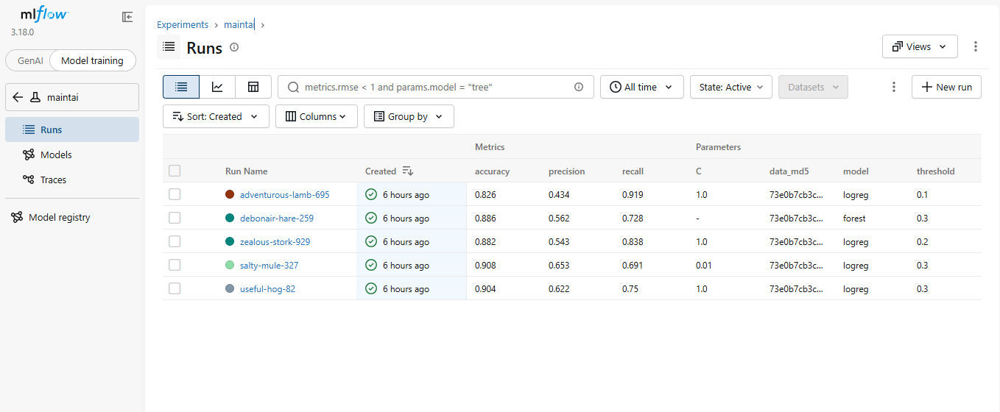

# Compte rendu · TP5 : suivre les entraînements (MLflow) et versionner les données (DVC)

**Groupe :** G1 5IA  ·  **Membres :** Sabrine Loksairi, Aya Haffari, Mohamed Amine Farih, Yasser Rais (dossier de : Aya Haffari)  ·  **Date :** 19/11/2026

---

## 1. Mise en place (dans `TP/TP5`)

Starter décompressé dans un dossier à moi (`TP5_S7\TP5`), environnement Python 3.12 neuf (`python -m uv venv --python 3.12 .venv`), puis installation des versions figées. Le polycopié demande `pip install -r requirements.txt` ; sur mon PC il a fallu l'écrire `python -m pip install --prefer-binary -r requirements.txt` (voir section « Difficultés »).

Versions installées (`pip list`) : mlflow 3.18.0, dvc 3.67.1, numpy 2.4.4, pandas 3.0.2, scikit-learn 1.8.0, pytest 9.1.1.

Dernière ligne de `python -m pytest` après `pip install -r requirements.txt` et `pip install -e .` :

```
================ 5 failed, 27 passed, 2 warnings in 29.84s ================
```

Quels tests échouent, et pourquoi ?

Les 5 tests de `tests/test_tracking.py` (`test_training_creates_a_run`, `test_run_records_metrics`, `test_run_records_data_version`, `test_run_stores_the_model`, `test_options_change_the_run`). Ils échouent avec `aucun run MLflow : log_run n'a rien enregistré` : `log_run` est vide et renvoie `""`, donc l'entraînement affiche « Run MLflow : » sans identifiant et MLflow ne contient aucun run.

Avant `pip install -e .`, où pointait le package `maintai` installé dans l'environnement ? Et après ?

Mon environnement était neuf : `maintai` n'y était pas du tout installé avant `pip install -e .`. Après, l'installation est « éditable » (`Successfully installed maintai-0.3.0`) : le package pointe vers mon dossier `TP5`, donc `import maintai` lit directement le code de `TP5` et les modifications de `tracking.py` sont prises en compte sans réinstaller.

## 2. Sprint 1 : MLflow

Ma fonction `log_run` (`maintai/tracking.py`) :

```python
def log_run(params: dict, metrics: dict, model, X_example, data_path: Path) -> str:
    """Enregistre un entraînement : paramètres, version des données, métriques et modèle. Renvoie l'id du run."""
    mlflow.set_experiment(EXPERIMENT)
    with mlflow.start_run() as run:
        mlflow.log_params(params)
        mlflow.log_param("data_md5", file_md5(data_path))
        mlflow.log_metrics(metrics)
        mlflow.sklearn.log_model(
            model,
            name="model",
            input_example=X_example,
            skops_trusted_types=TRUSTED_TYPES,
        )
    return run.info.run_id
```

Dernière ligne de `python -m pytest` à la fin du sprint 1 :

```
======================= 32 passed, 4 warnings in 55.03s =======================
```

Mes runs, relevés dans `mlflow ui` (mode « Model training ») et avec `mlflow.search_runs`. Les cinq premiers sont sur la v1 des données (5 000 lignes, `data_md5` 73e0b7cb), jeu de test de 1 000 lignes :

| Commande | recall | precision | accuracy |
|---|---|---|---|
| `python -m maintai.train` | 0.750 | 0.622 | 0.904 |
| `python -m maintai.train --C 0.01` | 0.691 | 0.653 | 0.908 |
| `python -m maintai.train --threshold 0.2` | 0.838 | 0.543 | 0.882 |
| `python -m maintai.train --model forest` | 0.728 | 0.562 | 0.886 |
| `python -m maintai.train --threshold 0.1` (mon essai) | 0.919 | 0.434 | 0.826 |

Les six runs avec leurs identifiants (sortie de `mlflow.search_runs`, `data_md5` raccourci) :

```
                          run_id params.model params.C params.threshold params.n_train params.data_md5  metrics.recall  metrics.precision  metrics.accuracy
e28be4953ec34a95b46f41d189527651       logreg      1.0              0.3           4000        73e0b7cb           0.750              0.622             0.904
e097a530a30847deaf195c9b4a2d5f50       logreg     0.01              0.3           4000        73e0b7cb           0.691              0.653             0.908
d585df2acb2c4269a54ed58ac35a56fa       logreg      1.0              0.2           4000        73e0b7cb           0.838              0.543             0.882
6a45d7c13a62418eb2869add19036846       forest      NaN              0.3           4000        73e0b7cb           0.728              0.562             0.886
979941ca76f3405fbe8b67eaab1f2af6       logreg      1.0              0.1           4000        73e0b7cb           0.919              0.434             0.826
549aa2be837244459122ef3307d7f712       logreg      1.0              0.3           6400        93fdeef2           0.741              0.650             0.916
```



Quel run choisiriez-vous pour MaintAI, et pourquoi ?

Le run `--threshold 0.2` (`d585df2a`) : rappel 0,838 et précision 0,543, donc il respecte le critère de la section 5 (rappel ≥ 0,75 et précision ≥ 0,50) avec une marge sur le rappel. Comme une panne manquée coûte plus cher qu'une fausse alerte, on préfère le rappel le plus haut tant que la précision reste au-dessus de 0,50. Le seuil 0,1 donne le meilleur rappel (0,919) mais sa précision (0,434) est sous le minimum. La forêt aléatoire n'est pas meilleure : rappel 0,728, plus faible que la régression logistique par défaut (0,750).

Dans `mlflow ui`, ouvrez le modèle d'un run. Quelle version de scikit-learn est indiquée dans son `requirements.txt` ? Quel problème du TP4 cela règle-t-il ?

Le `requirements.txt` enregistré avec le modèle contient `scikit-learn==1.8.0` (avec `numpy==2.4.4`, `pandas==3.0.2`, `scipy==1.18.1`, `skops==0.16.0`…). Cela règle le problème du TP4 : un modèle sauvegardé avec une version de scikit-learn peut échouer ou donner d'autres résultats quand on le recharge avec une autre version. Le run garde les versions exactes de l'entraînement, donc on sait avec quelles bibliothèques il faut le recharger.

Où MLflow enregistre-t-il les runs sur votre disque ? Ces fichiers vont-ils dans Git ? Pourquoi ?

Dans `mlflow.db` (la base SQLite, 1 032 192 octets, à la racine de `TP5`) et dans le dossier `mlruns/` (les modèles et leurs fichiers). Ils ne vont pas dans Git : `git check-ignore -v` montre qu'ils sont exclus par le `.gitignore` (lignes 11 et 12), et `git status` est vide. Ce sont des fichiers générés par les entraînements, lourds et propres à chaque machine, qui se recréent en relançant `python -m maintai.train`.

## 3. Sprint 2 : DVC

Contenu de `data/sensors.csv.dvc` après `dvc add data/sensors.csv` (v1) :

```
outs:
- md5: 73e0b7cb3c6f795c70c3ddf970b99c15
  size: 126815
  hash: md5
  path: sensors.csv
```

Comparez la valeur `md5` de ce fichier au paramètre `data_md5` de votre dernier run MLflow. Que constatez-vous ?

C'est la même empreinte : `73e0b7cb3c6f…` dans le reçu `.dvc`, et `73e0b7cb…` dans `data_md5` de mes cinq runs sur la v1. À partir d'un run MLflow, on retrouve donc exactement les données qui l'ont produit : il suffit de chercher le reçu `.dvc` qui porte ce md5 dans l'historique Git.

Pourquoi `data/sensors.csv` ne va pas dans Git, alors que `data/sensors.csv.dvc` y va ?

Un fichier de données peut être gros, et Git garde chaque version pour toujours, ce qui alourdit le dépôt. DVC garde le fichier dans son cache et son stockage, et ne met dans Git qu'un petit reçu de 4 lignes (md5, taille). Le reçu suffit pour retrouver la bonne version du fichier, et il suit le code dans l'historique Git.

Après `python -m maintai.dataset --n 8000 --seed 7`, `dvc status` signale que `data/sensors.csv` est modifié : le fichier ne correspond plus au md5 écrit dans `sensors.csv.dvc`. `dvc add` met ensuite à jour le reçu.

Reçu de la v2 :

```
outs:
- md5: 93fdeef2cac1893c4f720c16457eea75
  size: 202834
  hash: md5
  path: sensors.csv
```

Historique Git après la v2 :

```
c77a14e (HEAD -> master) Données v2
47e5c8a Données v1
2e953a6 DVC : init
06ab0fa TP5 : starter et log_run
```

| Version | Commit Git (`git log --oneline`) | md5 (8 premiers caractères) | Nombre de lignes |
|---|---|---|---|
| v1 | 47e5c8a | 73e0b7cb | 5000 |
| v2 | c77a14e | 93fdeef2 | 8000 |

Retour à la v1 (`git checkout 47e5c8a -- data/sensors.csv.dvc`, puis `dvc checkout`) : `data/sensors.csv` contient **5000 lignes**, et `git status` montre `M  data/sensors.csv.dvc` (l'ancien reçu, que je n'ai pas commité). Retour à la v2 (`git checkout HEAD -- data/sensors.csv.dvc`, puis `dvc checkout`) : **8000 lignes**, `git status` vide.

```
--- retour à la v1
M       data\sensors.csv
5000 lignes
M  data/sensors.csv.dvc
--- retour à la v2
M       data\sensors.csv
8000 lignes
```

Suppression de `data/sensors.csv` et du dossier `.dvc/cache`, puis `dvc pull` :

```
Fetching
A       data\sensors.csv
1 file fetched and 1 file added
8000 lignes
```

`dvc pull` retrouve le fichier dans le stockage (`%USERPROFILE%\dvc-stockage`) grâce au md5 du reçu, le copie dans le cache et recrée `data/sensors.csv` : c'est ce que ferait un coéquipier qui n'a pas les données.

## 4. Relier modèle et données

J'ai entraîné un modèle sur la v2 (mêmes réglages que le run par défaut : logreg, C = 1, seuil 0,3) et je le compare dans `mlflow ui` au run par défaut de la v1 :

| Run | data_md5 (8 caractères) | n_train | recall | precision |
|---|---|---|---|---|
| v1 (`e28be495`) | 73e0b7cb | 4000 | 0.750 | 0.622 |
| v2 (`549aa2be`) | 93fdeef2 | 6400 | 0.741 | 0.650 |

Peut-on dire que le modèle v2 est « meilleur » ? Pourquoi faut-il être prudent en comparant deux runs entraînés sur des données différentes ?

Non. Le rappel est un peu plus bas (0,741 contre 0,750), la précision un peu plus haute (0,650 contre 0,622) : l'écart est faible et n'est pas dans un seul sens. Surtout, les deux runs ne sont pas mesurés sur le même jeu de test : la v2 a ses propres 1 600 lignes de test (8 000 lignes au total), générées avec une autre graine (`--seed 7`), alors que la v1 a 1 000 lignes de test. Avec des données différentes, une différence de score peut venir du jeu de test plus facile ou plus difficile, du hasard, ou du modèle. On ne peut comparer honnêtement que des runs mesurés sur le même jeu de test.

## 5. Décision : l'ADR 004

`docs/adr/004-choix-du-modele.md` : régression logistique (C = 1) avec un **seuil de 0,2** (rappel 0,838 et précision 0,543, critère de la section 5 respecté). Identifiant du run : `d585df2acb2c4269a54ed58ac35a56fa` ; `data_md5` de la version des données utilisée : `73e0b7cb3c6f795c70c3ddf970b99c15` (v1).

## 6. Questions de compréhension

1. Quelle différence entre Git, DVC et MLflow ? Que versionne chacun ?
   Git garde le code et, pour les données, seulement le petit reçu `.dvc` (md5 et taille). DVC garde les fichiers de données, dans un cache et un stockage, et relie chaque version au reçu dans Git. MLflow garde chaque entraînement : paramètres, métriques, empreinte des données, modèle et versions des bibliothèques. Image du cours : MLflow est le cahier de manip, DVC est l'étiquette de l'échantillon.
2. Pourquoi le stockage DVC est-il ajouté avec `--local` dans ce TP ? Que faudrait-il pour que tout le groupe partage les mêmes données ?
   Le chemin d'un dossier de mon PC (`%USERPROFILE%\dvc-stockage`) n'a de sens que chez moi : `--local` l'écrit dans `.dvc/config.local`, ignoré par Git, donc il ne part pas dans le dépôt du groupe. Pour que tout le groupe partage les données, il faudrait un stockage accessible à tous (S3, Google Drive, un serveur) configuré dans le `.dvc/config` versionné : chacun ferait alors `dvc pull`.
3. Livrer un modèle, c'est trois choses (TP4). Lesquelles, et où sont-elles maintenant ?
   Le code (dans Git, et le wheel du TP4), les données (DVC : le reçu dans Git, le fichier dans le stockage) et le modèle (MLflow : un run et son identifiant), avec les versions exactes des bibliothèques dans le `requirements.txt` du modèle.

## 7. Le rendu Git

- Lien de la pull request : https://github.com/Sabrineloksairi/app-intelligente/pull/5 (PR commune du groupe pour le TP5, branche `tp5`)
- Le tag `tp5` existe sur GitHub : oui (créé par Sabrine Loksairi après la fusion de la PR)
- PR relue par : Sabrine Loksairi
- Son commentaire de relecture : « Relecture de tp/tp5/haffari : 32 passed sur mon PC, log_run enregistre les paramètres, data_md5, les métriques et le modèle, reçu data/sensors.csv.dvc présent, ADR 004 avec l'identifiant du run et le data_md5, aucun mlflow.db, mlruns, CSV ni cache DVC. »
- Réciproquement, j'ai relu `tp/tp5/loksairi` : 32 passed (dataset et tests lancés), `tracking.py` et ADR 004 relus, reçu `sensors.csv.dvc` présent, aucun `mlflow.db`, `mlruns`, `.env`, CSV ni cache DVC, puis approbation de la PR #5
- `git status` avant le commit : `mlflow.db`, `mlruns/`, `data/sensors.csv` ou `.dvc/cache` apparaissaient-ils ? non : `git check-ignore -v` les montre exclus par le `.gitignore` (et `.dvc/config.local` par `.dvc/.gitignore`), et `git status --short` est vide.

## 8. Ce qui reste flou

Ce qui reste flou pour moi, c'est comment une équipe partage vraiment les données avec DVC : ici le stockage est un simple dossier de mon PC, donc je n'ai pas vu un coéquipier faire `dvc pull` depuis une autre machine. Je comprends l'idée (un stockage partagé comme S3), mais pas encore comment on décide dans un vrai projet quand pousser une nouvelle version des données et comment éviter que le modèle et les données se désynchronisent.

## 9. Ticket de sortie · Séance 7

1. **Qu'est-ce que le MLOps ajoute au DevOps ?** Le DevOps gère une seule chose qui change, le code. Le MLOps en gère trois : le code, les données et le modèle. Il suit des métriques sur des données, comparées run par run, et il redéploie aussi quand les données dérivent, même sans nouveau code.
2. **Que versionnent Git, DVC et MLflow ?** Git : le code et le reçu `.dvc`. DVC : les fichiers de données. MLflow : chaque entraînement (paramètres, métriques, modèle, versions).
3. **Pourquoi `data/sensors.csv` n'est-il pas dans Git ?** Un fichier de données peut être lourd et Git garde chaque version pour toujours ; c'est son reçu `.dvc` (md5 et taille) qui va dans Git, le fichier est dans le cache et le stockage de DVC.
4. **À partir d'un run MLflow, comment retrouver ses données ?** On lit le paramètre `data_md5` du run, puis on cherche dans l'historique Git le reçu `data/sensors.csv.dvc` qui porte ce md5 ; `git checkout <commit> -- data/sensors.csv.dvc` puis `dvc checkout` (ou `dvc pull`) redonne le fichier.
5. **Qu'est-ce qui reste flou pour vous ?** Voir la section 8.

## 10. Difficultés rencontrées

| Problème | Cause | Solution |
|---|---|---|
| Le téléchargement de MLflow et de DVC était très long, et `pytest` manquait après une première installation interrompue | Connexion lente (environ 160 ko/s) et `Ctrl+C` pendant l'installation : pip a installé des versions plus récentes que celles figées dans `requirements.txt` | Relancer l'installation jusqu'au bout et vérifier les versions avec `pip list` (numpy 2.4.4, scikit-learn 1.8.0…) |
| `ERROR: Cannot install dvc because these package versions have conflicting dependencies` (`antlr4-python3-runtime`) | `--only-binary=:all:` interdit les paquets sans version précompilée, et `antlr4-python3-runtime` n'existe qu'en source | `python -m pip install --prefer-binary -r requirements.txt` |
| La fenêtre PowerShell qui affichait `mlflow ui` est passée en « mode débogage » et refusait `git init` | On y avait lancé des commandes pendant que `mlflow ui` tournait | Ouvrir une nouvelle fenêtre PowerShell, réactiver `.venv` et relancer les commandes |
| `python -m pytest` : 5 failed au départ | `log_run` n'était pas écrite (TODO) | Écrire `log_run` : 32 passed |

## 11. Exécution du travail

```powershell
python -m uv venv --python 3.12 .venv
.\.venv\Scripts\Activate.ps1
python -m ensurepip --upgrade
python -m pip install --prefer-binary -r requirements.txt
python -m pip install -e .
python -m maintai.dataset
python -m pytest                                  # 32 passed
python -m maintai.train                           # un run MLflow
python -m maintai.train --C 0.01
python -m maintai.train --threshold 0.2
python -m maintai.train --model forest
mlflow ui                                         # http://localhost:5000
git init ; dvc init
dvc add data/sensors.csv                          # reçu data/sensors.csv.dvc
dvc remote add --local -d stockage "$env:USERPROFILE\dvc-stockage"
dvc push
```

## 12. Conclusion

Chaque entraînement est maintenant un run MLflow qui garde ses paramètres, l'empreinte de ses données, ses métriques et son modèle avec les versions exactes des bibliothèques, et chaque version des données a son reçu dans Git grâce à DVC. J'ai pu choisir un modèle et un seuil (régression logistique, seuil 0,2) en le justifiant par le tableau des runs, et le relier à ses données par le `data_md5`.
