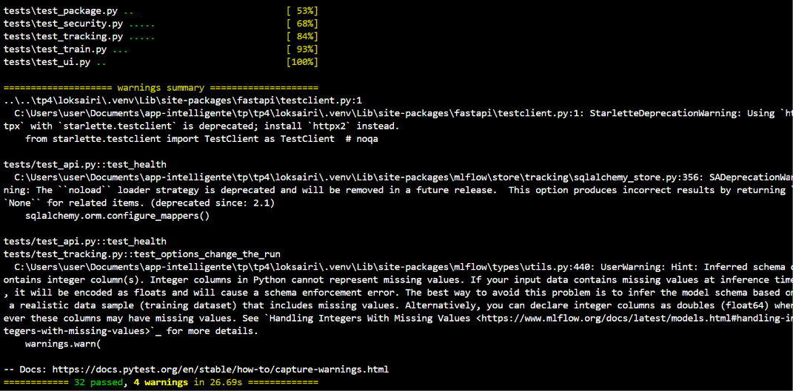
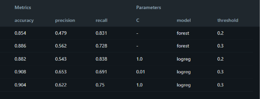
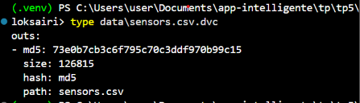
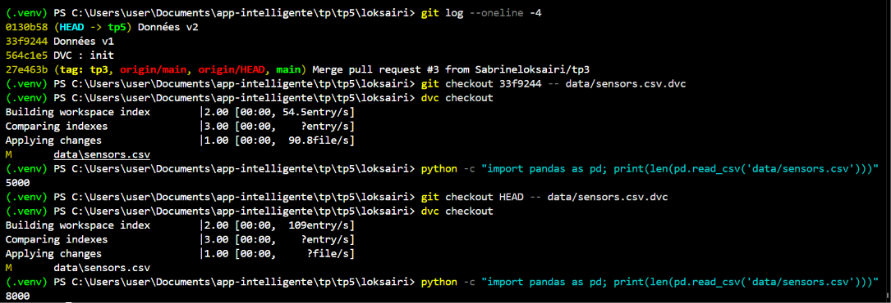
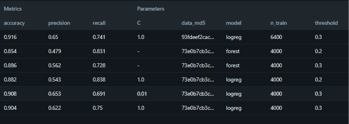

# Compte rendu · TP5 : suivre les entraînements (MLflow) et versionner les données (DVC)

**Groupe :** Sabrine Loksairi, Aya Haffari, Mohamed Amine Farih, Yasser Rais  ·  **Rédigé par :** Sabrine Loksairi  ·  **Date :** 19/11/2026

---

## 1. Mise en place (dans `TP/TP5`)

Dernière ligne de `python -m pytest` après `pip install -r requirements.txt` et `pip install -e .` :

```
================== 5 failed, 27 passed, 2 warnings in 10.49s ===================
```

Quels tests échouent, et pourquoi ?

Les 5 tests de `tests/test_tracking.py`. La fonction `log_run` renvoie encore une chaîne vide et n'enregistre rien dans MLflow : les tests ne trouvent aucun run (`aucun run MLflow : log_run n'a rien enregistré`).

Avant `pip install -e .`, où pointait le package `maintai` installé dans l'environnement ? Et après ?

Avant, il pointait vers le dossier du **TP4** : c'est là qu'avait été fait le `pip install -e .` de la séance précédente, et `pip show maintai` indiquait la version 0.2.0. Après, il pointe vers le dossier du **TP5**, en version 0.3.0. Une installation éditable n'est qu'un lien : on peut le déplacer d'un dossier à l'autre en relançant `pip install -e .`.

## 2. Sprint 1 : MLflow

Votre fonction `log_run` (`maintai/tracking.py`) :

```python
def log_run(params: dict, metrics: dict, model, X_example, data_path: Path) -> str:
    """Enregistre un entraînement : paramètres, version des données, métriques et modèle. Renvoie l'id du run."""
    mlflow.set_experiment(EXPERIMENT)
    with mlflow.start_run() as run:
        mlflow.log_params(params)
        mlflow.log_param("data_md5", file_md5(data_path))
        mlflow.log_metrics(metrics)
        mlflow.sklearn.log_model(model, name="model", input_example=X_example,
                                 skops_trusted_types=TRUSTED_TYPES)
    return run.info.run_id
```

Dernière ligne de `python -m pytest` à la fin du sprint 1 :

```
======================= 32 passed, 4 warnings in 12.44s ========================
```



Vos runs (au moins quatre), relevés dans `mlflow ui` (mode « Model training ») :

| Commande | recall | precision | accuracy |
|---|---|---|---|
| `python -m maintai.train` | 0.750 | 0.622 | 0.904 |
| `python -m maintai.train --C 0.01` | 0.691 | 0.653 | 0.908 |
| `python -m maintai.train --threshold 0.2` | 0.838 | 0.543 | 0.882 |
| `python -m maintai.train --model forest` | 0.728 | 0.562 | 0.886 |
| `python -m maintai.train --model forest --threshold 0.2` | 0.831 | 0.479 | 0.854 |



Quel run choisiriez-vous pour MaintAI, et pourquoi ? (Rappel : une panne manquée coûte plus cher qu'une fausse alerte.)

Je choisis **la régression logistique au seuil 0.2** : c'est le meilleur recall (0.838), donc le run qui manque le moins de pannes. En échange, la précision baisse à 0.543, soit plus de fausses alertes, ce qui reste acceptable puisqu'une fausse alerte coûte seulement une inspection. La forêt aléatoire n'est **pas meilleure** : au même seuil, elle a un recall et une précision plus faibles que la régression logistique. `--C 0.01` améliore la précision, mais manque encore plus de pannes. Le détail est dans `docs/adr/004-choix-du-modele.md`.

Dans `mlflow ui`, ouvrez le modèle d'un run. Quelle version de scikit-learn est indiquée dans son `requirements.txt` ? Quel problème du TP4 cela règle-t-il ?

Le fichier `requirements.txt` du modèle indique `scikit-learn==1.8.0`. Au TP4, le wheel installait scikit-learn 1.9.1 et le modèle déclenchait un `InconsistentVersionWarning` : il fallait lire `model_info.json` pour retrouver la bonne version. Ici, MLflow enregistre la version exacte avec le modèle : on sait immédiatement quoi installer pour le relire.

Où MLflow enregistre-t-il les runs sur votre disque ? Ces fichiers vont-ils dans Git ? Pourquoi ?

Dans le dossier `TP/TP5` : les paramètres et métriques dans la base `mlflow.db`, et les modèles dans le dossier `mlruns/`. Ils ne vont pas dans Git : ils sont dans le `.gitignore`. Ce sont des fichiers produits, qui grossissent à chaque entraînement et se régénèrent : Git est fait pour le code, pas pour des bases de données ou des modèles binaires.

## 3. Sprint 2 : DVC

Contenu de `data/sensors.csv.dvc` après `dvc add data/sensors.csv` :

```
outs:
- md5: 73e0b7cb3c6f795c70c3ddf970b99c15
  size: 126815
  hash: md5
  path: sensors.csv
```



Comparez la valeur `md5` de ce fichier au paramètre `data_md5` de votre dernier run MLflow. Que constatez-vous ?

C'est **la même valeur** : `73e0b7cb3c6f795c70c3ddf970b99c15` dans le reçu, et dans le paramètre `data_md5` des cinq runs entraînés sur la v1. `file_md5` calcule l'empreinte du fichier de la même façon que DVC : un run MLflow indique donc exactement sur quelle version des données il a été entraîné, et on peut retrouver cette version grâce au reçu DVC dans Git.

Pourquoi `data/sensors.csv` ne va pas dans Git, alors que `data/sensors.csv.dvc` y va ?

Un fichier de données peut être volumineux, et Git garderait chacune de ses versions pour toujours. DVC garde donc le fichier dans son cache et dans le stockage, et Git ne garde qu'un **reçu** de quelques lignes : l'empreinte md5, la taille et le nom du fichier. Le reçu suffit à retrouver la bonne version des données.

Après `python -m maintai.dataset --n 8000 --seed 7`, que dit `dvc status` ?

```
data\sensors.csv.dvc:
	changed outs:
		modified:           data\sensors.csv
```

DVC voit que le fichier ne correspond plus au reçu enregistré dans Git.

| Version | Commit Git (`git log --oneline`) | md5 (8 premiers caractères) | Nombre de lignes |
|---|---|---|---|
| v1 | `e828aeb` Données v1 | `73e0b7cb` | 5000 |
| v2 | `659a9fc` Données v2 | `93fdeef2` | 8000 |

Revenez à la v1 (`git checkout <commit> -- data/sensors.csv.dvc`, puis `dvc checkout`). Combien de lignes contient `data/sensors.csv` ? Puis revenez à la v2.

Le fichier contient **5000** lignes après le retour à la v1, et de nouveau **8000** après le retour à la v2. `git checkout` remet l'ancien reçu, puis `dvc checkout` remplace le fichier par la version correspondant à ce reçu, depuis le cache.



Supprimez `data/sensors.csv` et le dossier `.dvc/cache`, puis lancez `dvc pull`. Que se passe-t-il ?

DVC télécharge le fichier depuis le stockage (`1 file fetched and 1 file added`), et `data/sensors.csv` réapparaît avec ses 8000 lignes. C'est ce que fait un coéquipier qui clone le dépôt : il récupère le reçu avec Git, puis les données avec `dvc pull`.

## 4. Relier modèle et données

Entraînez un modèle sur la v2. Dans `mlflow ui`, comparez ce run à celui de la v1 avec les mêmes réglages :

| Run | data_md5 (8 caractères) | n_train | recall | precision |
|---|---|---|---|---|
| v1 (`e7c37513`) | `73e0b7cb` | 4000 | 0.750 | 0.622 |
| v2 (`31c6803e`) | `93fdeef2` | 6400 | 0.741 | 0.650 |



Peut-on dire que le modèle v2 est « meilleur » ? Pourquoi faut-il être prudent en comparant deux runs entraînés sur des données différentes ?

Non. Le run v2 a une meilleure précision (0.650 contre 0.622), mais un recall un peu plus faible (0.741 contre 0.750), qui est notre métrique principale. Surtout, les deux runs ne sont **pas évalués sur le même jeu de test** : 1 000 lignes de la v1 d'un côté, 1 600 lignes de la v2 de l'autre, avec un taux de panne différent (13,6 % contre 12,8 %). Un écart peut venir des données plutôt que du modèle. Pour comparer deux modèles, il faut les évaluer sur les mêmes données de test.

## 5. Décision : l'ADR 004

Dans `docs/adr/004-choix-du-modele.md` : régression logistique, `C = 1.0`, seuil 0.2, choisie pour son recall de 0.838. Run MLflow : `4e9de5c730f54326a000f45c90a443ae` ; données : `data_md5 = 73e0b7cb3c6f795c70c3ddf970b99c15` (v1, commit `e828aeb`).

## 6. Questions de compréhension

1. Quelle différence entre Git, DVC et MLflow ? Que versionne chacun ?
   **Git** versionne le code et les reçus `.dvc`. **DVC** versionne les fichiers de données, gardés dans un cache et un stockage hors de Git. **MLflow** garde la trace de chaque entraînement : ses paramètres, l'empreinte des données, ses métriques et le modèle avec les versions exactes des bibliothèques.
2. Pourquoi le stockage DVC est-il ajouté avec `--local` dans ce TP ? Que faudrait-il pour que tout le groupe partage les mêmes données ?
   Le stockage est un dossier de mon PC : son chemin n'a de sens que chez moi. `--local` l'écrit dans `.dvc/config.local`, ignoré par Git, pour ne pas imposer ce chemin aux autres. Pour partager les données, il faudrait un stockage accessible à tous, comme un bucket S3, Google Drive ou un serveur, déclaré sans `--local` dans `.dvc/config`, qui est commité.
3. Livrer un modèle, c'est trois choses (TP4). Lesquelles, et où sont-elles maintenant ?
   Le **code** est dans Git (et dans le wheel), le **modèle** est dans MLflow, retrouvable par l'identifiant de son run, et les **versions exactes** sont dans le `requirements.txt` du modèle enregistré par MLflow. Les **données** d'entraînement sont désormais retrouvables aussi, grâce au reçu DVC dans Git et au stockage.

## 7. Le rendu Git

- Lien de la pull request : https://github.com/Sabrineloksairi/app-intelligente/pull/5
- Le tag `tp5` existe sur GitHub : oui, créé sur `main` juste après la fusion de la pull request #5
- `git status` avant le commit : `mlflow.db`, `mlruns/`, `data/sensors.csv` ou `.dvc/cache` apparaissaient-ils ? non
- Relecture : Aya Haffari a relu et approuvé mon dossier. Son commentaire : « Relecture du dossier tp/tp5/loksairi : tests lancés (32 passed), tracking.py relu (log_run enregistre les paramètres, data_md5, les métriques et le modèle), ADR 004 présent avec le run et le data_md5, reçu sensors.csv.dvc présent, aucun mlflow.db, mlruns, .env, CSV ni cache DVC. Approuvé. » J'ai relu son dossier `tp/tp5/haffari` sur la même pull request (32 passed).

## 8. Ce qui reste flou

Je me demande comment mettre en place un stockage DVC partagé par tout le groupe, avec les droits d'accès de chacun. Je dois aussi comprendre comment détecter automatiquement une dérive des données, pour savoir quand ré-entraîner le modèle.
